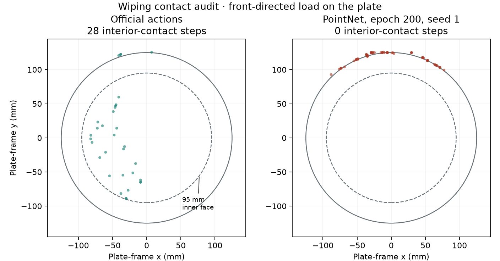
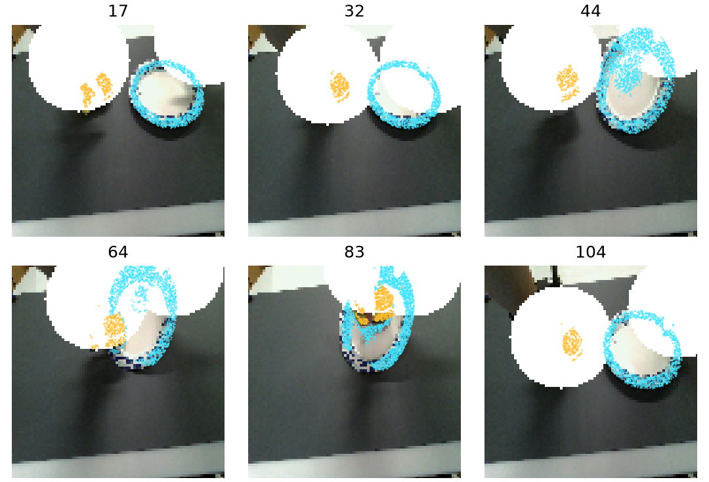
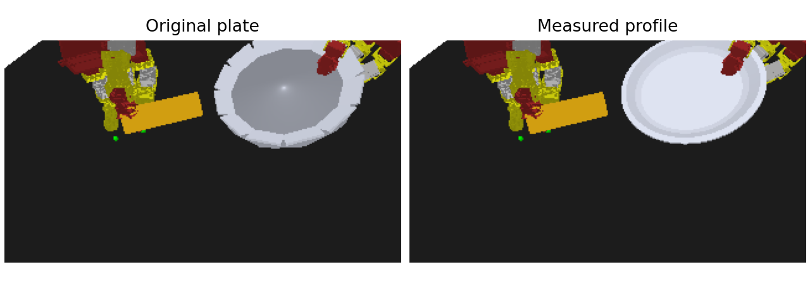
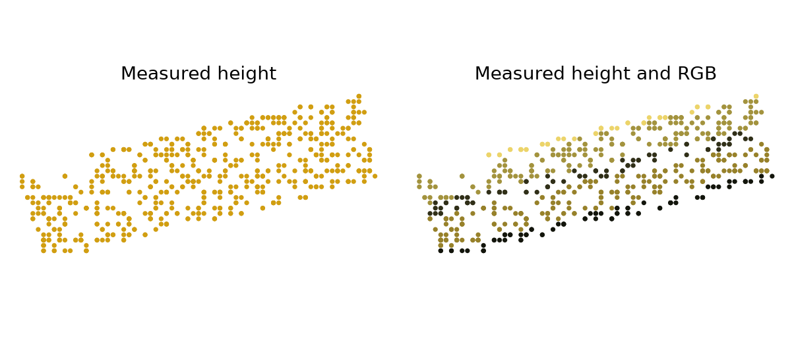
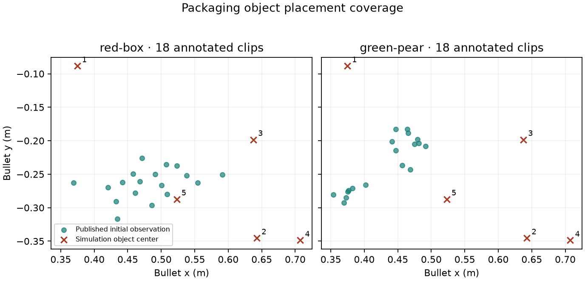

# 实验记录

## 源码基线

官方源码为 `j96w/DexCap@4b0bed0966c87368f3cde4476aadb7585c3b94b5`。`main` 的 `5ca7487` 修复了 HDF5 原始动作与归一化统计之间的精度不一致。测试在原版 `SequenceDataset` 上得到 `-1.00000207`，修复后通过。

## 本地硬件预验证

使用 Blackwell RTX 5070 Ti Laptop、Python 3.11、PyTorch `2.10.0+cu130`，从官方 Wiping HDF5 的第一条序列读取前 24 帧。PointNet 和 `SetXFPCDEncoder` 各跑 2 个 epoch、每个 3 步。两次都从 epoch 2 checkpoint 加载并输出有限的 46 维动作。这些运行用于验证训练与推理链路。

## pro1

项目位于 `~/dexcap-repro`。Conda 环境位于 `envs/train`，Python 3.11.18，PyTorch `2.10.0+cu130`，GPU 为 RTX PRO 5000 72 GB Blackwell。CUDA 张量运算已成功执行。

2026-11-19 20:01（北京时间），三个正式作业各已保存第 100 轮 checkpoint。每份约 280 MB，按每 100 轮保存一次估算，余下权重合计约 24.40 GB。清理 Conda 安装压缩包后，项目所在系统盘可用约 24.23 GB。`/data` 数据盘已挂载，当前项目账号尚无写权限。三个正式作业继续运行。

系统盘暂用无损压缩权重留出余量。PointNet 第 100 轮权重从 280,401,123 字节压到 260,871,659 字节，压缩前后逐张量完全相等，CUDA 在相同三帧观测和种子 1、2、3 下给出的 46 维动作逐元素相同。`dexcap-checkpoint-storage` 在三个训练日志确认文件写完后，逐字节验证 ZIP 内部数据，再把压缩文件原子替换到同一路径。第 3000 轮权重按训练器原格式保存。脚本与日志分别位于 `runs/compact-formal-checkpoints.py` 和 `runs/compact-formal-checkpoints.log`。

截至 20:08，脚本已处理五份权重，每份约省 19–20 MB。按这批实际大小估计，余下权重需约 22.25 GB，系统盘可用约 23.76 GB，约有 1.51 GB 余量。此数值随其他磁盘写入变化。

在两组 Wiping 分别到第 477、476 轮、Packaging 到第 512 轮时复核。系统盘可用 19.89 GiB。按实际压缩大小估算，剩余正式权重、日志增长和增强组的一个 checkpoint 合计约需 19.21 GiB。余量约 0.68 GiB，压缩临时文件另计。

23:19（北京时间），三组第 600 轮 checkpoint 均已保存并完成无损压缩，每份约 261 MB。此时系统盘可用 18.36 GiB。按生效配置，每组还需保存 23 份中间权重及 1 份第 3000 轮权重。用已保存文件的最大体积估算，合计约需 17.57 GiB，日志预计新增 0.21 GiB，另外预留 0.30 GiB 用于同时保存和压缩，剩余约 0.28 GiB。

Packaging 保存第 700 轮权重后，用同一方法无损压缩 22 份已结束的短训、单示范试验和 Packaging 平移对照权重。逐项比对归档内容后按原路径替换，共释放 456,977,146 字节（约 436 MiB）。系统盘可用 18.53 GiB，扣除剩余权重、日志和压缩临时空间后的预计余量约 0.70 GiB。脚本与日志在 `runs/compact-auxiliary-checkpoints.{py,log}`。

11 月 19 日 23:59（北京时间），Packaging 第 800 轮权重已保存并无损压缩为 260,877,286 字节。系统盘可用降至约 17.02 GiB，当时后续权重、日志及压缩临时空间预计共需 17.59 GiB。将安装完成后留存的 Miniconda 下载文件转存到本地工作区的 `runs/installer-cache/` 后，服务器可用升至 17.22 GiB。三组训练继续运行，当前预计还差约 0.37 GiB，已请求提供可写的持久数据盘目录。

11 月 20 日 00:07（北京时间），两组 Wiping 的第 700 轮权重均已保存并完成压缩。系统盘可用 16.73 GiB，剩余存储缺口估算约 0.37 GiB。对 Packaging 第 800 轮权重只读试算，DEFLATE 从级别 1 调到 6 只多省 739,254 字节。即使其余 65 份中间权重都能省同样多，也只释放约 46 MiB。

00:31（北京时间），Packaging 第 900 轮权重已保存并压缩为 260,904,068 字节，两组 Wiping 各到第 753 轮。系统盘可用 13.90 GiB，按原保存计划估算仍需约 16.86 GiB。已确认 20 份完成的短训和单示范试验权重共占约 4.83 GiB，可作为获得授权后的转存对象。三组正式训练继续运行。

01:05（北京时间），Packaging 第 1000 轮权重已保存并压缩为 260,943,068 字节。此时两组 Wiping 到第 823、824 轮，第 800 轮权重均已保存并压缩。三组所有完整轮次的训练损失均为有限值。系统盘可用约 13.18 GiB，后续权重、日志与压缩临时空间预计还需约 16.13 GiB。

02:34（北京时间），两组 Wiping 均已保存及压缩第 1000 轮权重，训练到第 1004 轮。Packaging 到第 1258 轮。按最近 40 轮的中位耗时，预计 Packaging 约 12:09 完成训练，两组 Wiping 约 19:04、19:08 完成训练。正式评估在各组权重保存结束后开始，仍受后续可用空间影响。当时系统盘可用约 11.69 GiB，完训估算还需约 14.67 GiB。

02:51（北京时间），Packaging 第 1300 轮权重已保存并压缩，系统盘可用 11.44 GiB，完训估算还需约 14.39 GiB。用三组最近 40 轮中位速度、每 100 轮保存一次的有效配置、实测权重大小和日志增长率，逐次估算保存时的空间。若项目外磁盘占用与训练速度保持当前水平，预计 14:50 左右 Wiping PointNet 第 2500 轮压缩临时空间会首先不足，14:55 左右 Wiping SetXF 的同轮权重可能写入失败。

03:59（北京时间），Packaging 已过半，第 1500 轮权重保存并压缩为 261,140,416 字节。Packaging 到第 1505 轮，两组 Wiping 到第 1175、1176 轮，已记录的训练损失均为有限值。系统盘可用约 10.47 GiB，预计后续权重、日志和压缩临时空间仍需约 13.41 GiB。

06:54（北京时间），两组 Wiping 的第 1500 轮权重与 Packaging 的第 2000 轮权重均已保存并压缩。三组训练日志分别记录到 Wiping 第 1528、1528 轮和 Packaging 第 2005 轮，全部已记录损失均为有限值。系统盘可用约 7.29 GiB，完训估算还需约 10.25 GiB。

08:43（北京时间），已用 `rsync` 将 20 份完成的短训和单示范试验权重复制到本地工作区的 `runs/auxiliary-checkpoint-archive/`，按原相对路径保存。传输成功，20 份文件的大小逐项匹配，共 5,190,853,965 字节。清单为该目录的 `sources.tsv`。服务器副本保留原路径，释放这些空间等待转存授权。此时两组 Wiping 的第 1700 轮与 Packaging 第 2300 轮权重均已保存并压缩，系统盘可用 5.50 GiB，预计完训还需约 8.55 GiB。

10:02（北京时间），确认 `/data` 已对项目账号开放写入。将这 20 份完成的辅助权重复制至同一台服务器的 `/data/dexcap-repro/auxiliary-checkpoints/`，逐文件字节比对并同步落盘后，用指向数据盘的链接替换原路径入口。原命令仍可从项目的 `runs/` 加载这些权重，磁盘之间转存的文件清单在数据盘目录的 `sources.tsv`。系统盘可用 8.82 GiB，按生效保存配置和实测文件大小，余下权重、日志及压缩临时空间约需 7.01 GiB，预计留有 1.81 GiB 余量。此时两组 Wiping 均已保存第 1900 轮，Packaging 到第 2543 轮，三组训练进程均在运行。

10:47（北京时间），两组 Wiping 均已保存并压缩第 2000 轮权重，Packaging 到第 2675 轮。系统盘可用 11.59 GiB，按剩余 24 份正式权重、此前估算的日志增长和压缩临时空间，预计完训还需约 6.3 GiB。项目数据仍在 `data/`，数据盘上的项目存储是上述辅助权重目录。

`60d5b3a` 的 `scripts/run_experiment.sh` 已在 `pro1` 的三个实验入口分别跑通 `smoke`。Wiping PointNet 使用当前项目源码，其余两组使用 `worktrees/setxf` 的 `4263783`。三个第 2 轮 checkpoint 均输出有限的 46 维动作。入口日志为 `runs/repro-entrypoint-pointnet.log`、`runs/repro-entrypoint-wiping-setxf.log` 和 `runs/repro-entrypoint-setxf.log`。   [运行方式](reproduction.md#运行一次完整实验)

### Wiping 全量训练启动

2026-11-19 18:30（北京时间），Wiping 完整 HDF5 已落盘。PointNet 和 SetXF 的训练日志均报告 255 条示范和 27901 个有效序列。两组均完成两轮全数据短训，第 2 轮 checkpoint 都能输出有限的 46 维动作，随后进入正式训练。每组计划 3000 轮，每轮 500 个梯度步。

| 编码器 | GPU | 训练源码 | 正式训练目录（在 `runs/` 下） |
|---|---:|---|---|
| PointNet | 0 | `70da97f` | `wiping-pointnet-seed1-full-20261119T102945Z` |
| SetXF | 1 | `4263783` | `wiping-setxf-seed1-full-20261119T103025Z` |

两个正式作业保存的 `config.json` 只有 `experiment.name` 不同。两版训练源码在 `DexCap/STEP3_train_policy` 的行为差异是点云编码器的选择与初始化参数，训练日志也分别打印了 `PointNet` 和 `SetXFPCDEncoder` 实例。

旧下载等待器在文件落盘交接时提前退出了 Wiping SetXF。该组从落盘的文件经 `scripts/run_experiment.sh wiping-setxf full` 启动，在同一任务内顺序运行训练、加载权重和配对仿真。Packaging 的下载保持运行，`dexcap-packaging-setxf` 等待最终文件后使用同一入口。PointNet 沿用已启动的训练与评估队列。

在 `pro1` 的 `dexcap-wiping-epoch100` 会话安排第一次全数据权重对照。两组第 100 轮 checkpoint 均保存完成后，分别用 GPU 3 和 4 执行相同的 3 个种子，每个 400 步。结果输出到 `runs/wiping-{pointnet,setxf}-epoch100-preliminary.json`，正式结果在第 3000 轮上按 20 个配对摆放评估。

两组第 100 轮对照使用 `06a378d` 的仿真和发布版动作队列。结果 JSON 中三对种子的盘子和海绵起点完全一致。

| 编码器 | 抓盘回合 | 抓海绵回合 | 两件均抓取 | 仿真达标 |
|---|---:|---:|---:|---:|
| PointNet | 1/3 | 1/3 | 0/3 | 0/3 |
| SetXF | 2/3 | 2/3 | 1/3 | 0/3 |

六个回合的盘面正面接触步和完整擦拭次数均为 0。两组在持续训练。

### Wiping 正式仿真结果

2026-11-20 18:41（北京时间），两组训练都已记录成功并保存第 3000 轮权重。PointNet 和 SetXF 分别在 GPU 0、1 上读取各自的最终权重，在同一份官方 HDF5 和同一组 20 个初始摆放上并行运行，每回合 400 步。

| 编码器 | 抓盘 | 抓海绵 | 两件均抓取 | 内盘面接触 | 完整成功 |
| --- | ---: | ---: | ---: | ---: | ---: | ---: |
| PointNet | 8/20 | 10/20 | 6/20 | 0/20 | 0/20 |
| SetXF | 13/20 | 12/20 | 10/20 | 1/20 | 0/20 |

SetXF 在种子 9 的回合有 41 步内盘面接触，累计接触位移约 0.132 m，按仿真判据计得 0 次完整擦拭。逐回合记录为 `runs/wiping-pointnet-seed1-final-sim.json` 和 `runs/wiping-setxf-seed1-full-20261119T103025Z.final-sim.json`。 [仿真判据](simulation.md) · [正式汇总 JSON](assets/dexcap-formal-simulation.json)

约 19:08，本批 115 个回合已汇总，`data/`（约 41 GiB）和 `runs/`（约 23 GiB）已迁至 `/data/dexcap-repro/`，原项目入口改为目录链接。系统盘可用约 69 GiB，数据盘可用约 3.0 TiB。通过原路径重新打开两份 HDF5 并重新汇总原始记录，得到相同的结果。 [服务器目录](reproduction.md#项目目录)

### Wiping 动作时序对照

发布代码已从预测序列中取出与最后一帧观测对齐的 10 个动作，入队时再次切片，丢掉前三步，只执行剩余七步。`main` 的 `e5eaa5a` 和 `repro/setxf` 的 `e30fe9e` 让后续仿真执行完整队列。两分支在 `pro1` 的 Conda 环境通过了顺序执行 10 步且只请求一次扩散轨迹的回归测试。现有 checkpoint 可直接用于修正后的推理。

保持两组第 100 轮 checkpoint 不变，取官方 `demo_0` 的帧索引 2、10、17、22、26、28、32、38、44、54、64、72、83、95、104。输入截至该帧的三帧观测，分别使用扩散种子 1、2、3，将首次执行动作与该帧官方动作比较。仿真观测来自官方动作驱动的同一场景，沿用首帧固定相机。表中为腕部位置误差中位数，单位为 mm。

| 输入 | 编码器 | 右腕 | 左腕 |
|---|---|---:|---:|
| 官方观测 | PointNet | 24.6 → 16.7 | 37.1 → 14.2 |
| 官方观测 | SetXF | 17.3 → 12.7 | 21.2 → 13.8 |
| 仿真观测 | PointNet | 24.1 → 16.5 | 35.9 → 18.0 |
| 仿真观测 | SetXF | 17.6 → 20.4 | 30.1 → 18.9 |

在擦拭阶段的仿真观测中，PointNet 的左腕误差从 69.2 mm 降至 26.0 mm，SetXF 从 42.8 mm 降至 17.6 mm。逐时刻数据与运行脚本位于 `pro1` 的 `runs/wiping-{pointnet,setxf}-epoch100-action*-diagnostics.json` 和 `runs/wiping-epoch100-replay-diagnostics.py`。

在 `demo_0` 的参考摆放上，各用种子 1 做 400 步闭环。PointNet 从只抓起海绵变为同时抓起两件物体，两个版本的盘面正面接触均为 0 步。SetXF 两个版本都抓起两件物体，正面接触从 8 步变为 6 步。四个回合的完整擦拭次数均为 0。记录为 `runs/wiping-{pointnet,setxf}-epoch100-{reference,action-aligned-reference}.json`。

在与初次对照完全相同的三组随机摆放上，两组各跑 400 步。PointNet 抓盘回合由 1/3 增至 2/3，盘面正面接触仍为 0。SetXF 同时抓起两件物体的回合保持 1/3，种子 1 从无正面接触变为 5 步正面接触，接触期间累计相对移动 0.0133 m。修正前后两组均为 0/3 成功。记录为 `runs/wiping-{pointnet,setxf}-epoch100-action-aligned-trials.json`。

官方 Wiping、Packaging 配置和 `pro1` 三个正式作业的生效配置均为 `algo.ema.enabled=false`。Wiping 两个第 100 轮 checkpoint 加载时没有 EMA 模型。尝试把点云编码器与去噪网络统一选到 EMA 分支后，两组 15 个时刻的逐项动作误差完全一致，确认该分支在本次实验中未启用。

`dexcap-wiping-epoch200` 等两组第 200 轮 checkpoint 保存后，分别用 GPU 5 和 6 重跑相同的 3 个种子，每回合 400 步，结果写入 `runs/wiping-{pointnet,setxf}-epoch200-aligned-trials.json`。动作队列和 Wiping 摆放沿用第 100 轮修正后的对照。

### Wiping 第 200 轮配对结果

两种编码器的三个起点与各自第 100 轮逐项一致，两个编码器使用相同摆放。两组各跑完 3 × 400 步。表中擦拭次数沿用当时仅按法向区分正侧接触的判据。 [盘沿接触审计](#擦拭接触点审计)

| 编码器 | 第 100 轮两件都抓到 | 第 200 轮两件都抓到 | 第 100 轮完成擦拭 | 第 200 轮完成擦拭 |
|---|---:|---:|---:|---:|
| PointNet | 0/3 | 2/3 | 0/3 | 1/3 |
| SetXF | 1/3 | 2/3 | 0/3 | 0/3 |

旧判据在 PointNet 种子 1 累计 47 步正侧接触，接触期间的相对位移为 0.4227 m，于第 37 和 77 步各计一次擦拭。SetXF 在同一摆放有 1 步正侧接触，擦拭为 0。正式对照以第 3000 轮的 20 组配对摆放为准。

沿用第 100 轮动作对照的 15 个时刻、三个扩散种子和官方动作驱动的仿真观测，重测第 200 轮权重。PointNet 的仿真右、左腕中位误差由 16.5、18.0 mm 降至 10.4、11.4 mm，SetXF 由 20.4、18.9 mm 降至 12.9、16.0 mm。擦拭阶段，PointNet 和 SetXF 的左腕误差分别降至 12.8 mm 和 14.9 mm。逐帧数据位于 `runs/wiping-{pointnet,setxf}-epoch200-action-diagnostics.json`。

#### 擦拭接触点审计

用同一第 200 轮 PointNet checkpoint 和种子 1 重跑，逐步记录接触点在盘子自身坐标中的位置和法向力。两次计数发生时触点距盘心约 125–128 mm，高约 22 mm，位于斜盘沿。47 步正侧接触中，距离盘心最近的触点为 123.7 mm，内盘面半径为 95 mm。按内盘面接触计，该回合为 0 次擦拭。

相同审计用于 111 步官方 `demo_0` 动作。原判据为 31 步正侧接触，内盘面判据为 28 步内盘面接触，两种判据均计 4 次擦拭。接触点和力的数据位于 `runs/wiping-{demo0,pointnet-epoch200-seed1}-face-contact-audit.json`。



将内盘面判据部署到 `pro1` 后，正常入口回放官方 `demo_0` 仍得到 28 步内盘面接触和 4 次擦拭。两组第 200 轮权重按原来的三个种子各重跑 400 步，起点、两件物体的抓取状态和所有海绵与盘子接触步数均与旧评分对应回合一致。六个回合的内盘面接触和擦拭次数均为 0。正式评估使用更新后的内盘面判据。结果在 `runs/wiping-demo0-interior-pro1.json` 和 `runs/wiping-{pointnet,setxf}-epoch200-interior-trials.json`。

### Wiping 第 300 轮配对结果

两组复用 `demo_0` 的 15 个时刻与三个扩散种子。每格为右腕、左腕的位置误差中位数，单位 mm。逐项数据在 `runs/wiping-{pointnet,setxf}-epoch300-action-diagnostics.json`。版本化诊断命令与 PointNet 原诊断的 180 组动作误差逐项一致。 [诊断命令](simulation.md#比较录制观测和仿真观测)

| 观测 | PointNet | SetXF |
|---|---:|---:|
| 录制点云和腕部状态 | 6.4、6.4 | 12.8、7.2 |
| 录制相机渲染点云、录制腕部状态 | 9.1、13.6 | 15.8、16.6 |
| 固定相机渲染点云、录制腕部状态 | 8.9、15.3 | 15.6、17.1 |
| 固定相机渲染点云、仿真腕部状态 | 8.9、15.3 | 15.7、16.9 |

只更换点云时，两个编码器的两腕误差中位数都增大。固定点云后，更换腕部状态最多带来约 0.2 mm 的变化。擦拭阶段在完全仿真观测下，PointNet 的左腕误差从第 200 轮的 12.8 mm 增至 16.1 mm，SetXF 从 14.9 mm 降至 10.6 mm。

与第 200 轮逐项配对，两组各执行三次 400 步闭环。PointNet 有 0/3 回合抓到两件物体，SetXF 有 1/3。SetXF 在种子 1 和 3 分别有 1 步和 22 步海绵与盘子的接触。六个回合的内盘面接触均为 0，任务成功均为 0/3。结果在 `runs/wiping-{pointnet,setxf}-epoch300-interior-trials.json`。

#### 分开交换手部与场景点

固定录制相机外参和腕部状态，在上述第 300 轮权重上单独交换两类点。距任一掌心不超过 22 cm 的零 RGB 点划为手部，其余点为场景。每帧的手部点数和场景点数匹配录制数据。三帧窗口中两种来源的每类点至少 64 个，15 个时刻中有 13 个满足。两个编码器对每个时刻各用三个扩散种子在 CPU 上推理。

| 手部点与场景点来源 | PointNet 右腕、左腕 | SetXF 右腕、左腕 |
|---|---:|---:|
| 全部录制 | 6.4、6.1 mm | 11.2、6.4 mm |
| 仅手部点来自仿真 | 6.3、6.3 mm | 11.0、6.3 mm |
| 仅场景来自仿真 | 7.3、12.8 mm | 16.2、13.5 mm |
| 两类点均来自仿真 | 7.8、12.7 mm | 15.9、14.0 mm |

表中是每种输入的腕位误差中位数。按同一时刻和种子先做差，再取中位数时，只换场景点使两组左腕误差都增加 7.0 mm，只换手部点分别变化约 0.0 和 −0.1 mm。在这组固定点数的对照中，主要差异随场景点变化。脚本和逐项数据在 `runs/wiping-hand-scene-swap.py` 和 `runs/wiping-{pointnet,setxf}-epoch300-hand-scene-swap.json`。

#### 固定场景颜色后交换三维坐标

沿用同样的 13 个时刻和三个扩散种子，保留录制手部点、录制腕位和相同的场景采样。每帧取录制场景点的 RGB 中位数，作为两种来源的所有场景点的颜色。表中为把录制场景坐标换成仿真坐标后，同一时刻和种子的腕位误差增量中位数，单位 mm。

| 场景点的 RGB | PointNet 右腕、左腕 | SetXF 右腕、左腕 |
|---|---:|---:|
| 各自原色 | +1.8、+7.0 | +5.5、+7.0 |
| 两边共用每帧的录制 RGB 中位数 | +0.2、−1.3 | −0.9、+7.0 |

PointNet 使用录制场景时，左腕误差的绝对中位数从 6.1 mm 增至 11.7 mm，说明统一颜色也移除了录制输入中的有用信息。SetXF 在同色条件下仍对两种场景几何给出不同的左腕动作，擦拭阶段的配对误差增量为 +2.7 mm。逐项记录和脚本在 `runs/wiping-{pointnet,setxf}-epoch300-scene-xyz.json`、`runs/wiping-scene-xyz.py`。

另保留仿真点的 XYZ，并用距离不超过 15 mm 的最近录制点替换 RGB。逐帧替换比例中位数为 55%，范围 18.6%–95.7%。近邻换色使 PointNet 和 SetXF 的左腕误差分别下降 0.5 mm 和 0.1 mm。相对于录制场景，两组仍分别高出 5.4 mm 和 7.0 mm，均为配对差的中位数。这一方法检验两种几何重叠位置的 RGB。逐项记录和脚本在 `runs/wiping-{pointnet,setxf}-epoch300-scene-color-transfer.json`、`runs/wiping-scene-color-transfer.py`。

#### 按距手掌的距离交换场景点

保留录制手部点，把场景分成距任一掌心 22 cm 内和以外两组。三帧窗口中两种来源的每组都至少有 64 点的时刻共有 10 个，其中 3 个处于擦拭阶段。每一组按录制点数独立采样。表中是交换场景区域后，同一时刻与种子之间的腕位误差增量中位数，单位 mm。

| 换成仿真的场景区域 | PointNet 右腕、左腕 | SetXF 右腕、左腕 |
|---|---:|---:|
| 距掌心 22 cm 内 | +0.8、+7.5 | +5.3、+6.6 |
| 距掌心 22 cm 外 | −0.2、−0.3 | +0.9、+2.5 |
| 两片区域 | +1.9、+6.1 | +6.8、+8.5 |

这批时刻里，离掌心较近的场景点带来的误差较大。这个分区同时包含操作物体和邻近桌面，结果指向这片操作区域。逐项记录及脚本在 `runs/wiping-{pointnet,setxf}-epoch300-scene-region-swap.json`、`runs/wiping-scene-region-swap.py`。

#### 分别对齐盘子与海绵的位置

从官方 `demo_0` 的近手点云恢复同一批 38 帧的物体中心。盘子用蓝色盘沿的 159–493 点作 110 mm 固定半径圆拟合。各帧径向残差中位数为 3.5–5.9 mm，并沿估计法向回退 12 mm 将可见圆心换算到 Bullet 盘底原点。海绵用左掌附近的 233–607 个黄色点取去除小离群簇后的包围中心，该中心仍受可见面遮挡影响。两套拟合与数据在 `runs/wiping-recorded-{plate,sponge}-poses.{py,json}`。

先完成官方动作驱动的物理回放，再使用已记录的姿态渲染。直接在物理回放中挪动物体并恢复状态会改变后续回放，故正式试验的临时位移仅进入渲染层。第 44 帧的离线基线点云与正常物理回放的同帧渲染一致。单次只移动一个物体中心，沿用该帧仿真姿态、录制相机、腕位及手部点数。

盘子中心的三维差距在仿真触发抓取前中位为 12.2 mm（10 帧），触发后为 21.5 mm（28 帧）。海绵分别为 20.6 mm（3 帧）和 40.3 mm（35 帧）。两种编码器的同一动作回放得到逐项一致的几何数据。

下表为第 300 轮策略在 13 个时刻、三个扩散种子下，单独对齐物体中心相对于原仿真场景的腕位误差增量中位数，单位 mm。

| 对齐的物体 | PointNet 右腕、左腕 | SetXF 右腕、左腕 |
|---|---:|---:|
| 盘子 | 0.0、+0.2 | +0.5、+0.2 |
| 海绵 | −0.1、−0.7 | −0.2、+0.5 |

对齐中心的配对变化在 1 mm 以内。单独对齐海绵后的 PointNet 左腕误差中位数为 11.7 mm，录制输入为 6.2 mm。SetXF 对齐盘子在擦拭阶段的配对左腕误差降幅为 0.6 mm，全段配对误差增加 0.2 mm。这两项位置修正都留下了多毫米的观测误差。逐项记录和脚本在 `runs/wiping-{pointnet,setxf}-epoch300-object-position-ab.json`、`runs/wiping-object-position-ab.py`。

#### 同时对齐中心与盘面法向

在同一批 38 帧中，海绵相对于盘子中心的三维位置差在两个仿真抓取都触发之前中位为 15.3 mm（10 帧），之后为 36.8 mm（28 帧）。抓盘后，拟合的录制盘面与仿真盘面法向夹角中位数为 4.8°。

沿用上述 13 个时刻、三个种子及按帧的点数采样，额外同时移动两物体。另一组还按最小旋转将仿真盘面法向对齐到录制估计。海绵沿用仿真朝向。表中为相对原仿真渲染的腕位误差配对增量中位数，单位 mm。

| 渲染中的对齐项 | PointNet 右腕、左腕 | SetXF 右腕、左腕 |
|---|---:|---:|
| 两个物体中心 | 0.0、−0.5 | +0.7、+1.5 |
| 两个物体中心和盘面法向 | 0.0、−0.6 | +0.5、+2.1 |

用 Bullet 分割缓冲区追踪 13 个时刻的渲染点来源。掌心 22 cm 内的非手部点合计 71.4% 来自盘子、28.6% 来自海绵。按当前裁剪设置，这批近手渲染点没有桌面点。几何对照与分割记录分别在 `runs/wiping-{pointnet,setxf}-epoch300-object-pose-ab.json` 和 `runs/wiping-near-scene-parts.json`。复算脚本为 `runs/wiping-object-pose-ab.py`、`runs/wiping-near-scene-parts.py`。

#### 逐个交换盘子和海绵的表面点

用 Bullet 的逐像素物体标签识别采样后的仿真盘子和海绵点。录制点云中，盘子取此前拟合的盘面附近及半径 13 cm 内的点，海绵取估计中心附近的黄色点。抽查六帧，将两类录制点投影到发布数据的 RGB 画面。替换时使用原仿真物体的点数，保留其他场景点、录制手部点、腕位与原有采样顺序。



在 13 个时刻、三个扩散种子上，仿真基线的逐项动作误差与前一场景对照完全一致。逐帧候选盘子点数的中位数为录制 1451、仿真 4265，海绵为录制 275、仿真 1100。录制表面点数少于替换槽位时有放回采样。表中为相对仿真基线的配对腕位误差增量中位数，单位 mm。

| 使用录制表面的物体 | PointNet 右腕、左腕 | SetXF 右腕、左腕 |
|---|---:|---:|
| 盘子 | +0.3、+0.3 | −2.8、−2.1 |
| 海绵 | −0.8、−5.5 | +1.0、+1.9 |
| 两者 | −0.6、−5.5 | −0.1、+3.1 |

PointNet 在擦拭阶段只换海绵时，左腕配对误差中位数下降 6.6 mm。SetXF 在全段只换盘子时两腕误差都下降。两种编码器对物体表面的敏感性不同。该对照使用对应时刻的录制表面，分析范围为离线首次动作。脚本和逐项输出在 `runs/wiping-object-surface-swap.py` 和 `runs/wiping-{pointnet,setxf}-epoch300-object-surface-swap.json`。

另在帧索引 38–95 的拟合盘子点上估计径向剖面。每个半径区间每帧至少取 32 点。以 0–65 mm 区间为零，半径 65–90、95–105、110–120、120–130 mm 的表面高度分别为 −0.3、+5.0、+17.5、+16.5 mm，由每帧高度中位数再取跨帧中位数得到。这个剖面可作为盘面渲染的直接几何标定数据。

#### 用实测剖面渲染盘面

把径向测量做成直径 250 mm、总高度 21.5 mm 的闭合盘面网格，共 1024 个三角面。盘底到盘沿的高度用分段线性插值，厚度沿用 4 mm。先按原碰撞模型完成回放，再用已保存的物体和手部姿态渲染新网格。两个渲染版本使用相同材质参数，网格法向会影响明暗。



这次实验沿用第 300 轮权重、13 个配对时刻和三个扩散种子。PointNet 的全段两腕配对误差中位数均变化约 0.0 mm，SetXF 右腕增加 1.6 mm、左腕增加 2.0 mm。图形换成更接近测量剖面的外形后，尚未得到稳定的动作改善。网格为 `runs/wiping-measured-plate-profile.obj`，脚本和输出为 `runs/wiping-plate-profile-ab.py`、`runs/wiping-{pointnet,setxf}-epoch300-plate-profile-ab.json`。

对 SetXF 再令两种场景的非手部点共享同一帧的录制 RGB 中位数。此时网格相对原盘面的配对误差中位变化为右腕约 0.0 mm、左腕 −0.2 mm。原色条件下的误差增加在同色条件下没有出现，说明网格的成像颜色及其与几何的相互作用也影响该对照。正式仿真沿用原盘面。脚本及结果为 `runs/wiping-plate-profile-neutral.py` 和 `runs/wiping-setxf-epoch300-plate-neutral-{primitive,profile}.json`。

#### 用原始 RGB-D 标定海绵分层外观

在抓取前的官方 `frame_2220` 中，用五个图像多边形选取海绵顶面、上层侧面、中间深色层、下层黄色区和底部深色层。将有效深度点投影到 Bullet 坐标。五个区域各有 922–6499 个点。顶面、中间深色区和底部深色区的 (z) 中位数分别为 3.5、−9.0、−29.3 mm。标定脚本和完整 RGB 数值在 `runs/wiping-measure-sponge-bands.py`、`runs/wiping-sponge-measured-bands.json`。

原型沿用 130 × 80 mm 的平面尺寸，把可见高度从 40 mm 改为 34 mm。第二个版本在同一组三维点上按局部高度赋五个测得的 RGB 中位数。第 44 帧样例中，654 个海绵点改变颜色，整帧 XYZ 逐项一致。两种版本都使用保存的物理回放姿态渲染。



使用第 300 轮权重、同一 13 个时刻和三个扩散种子。表中为相对原仿真渲染的腕位误差配对增量中位数，单位 mm。

| 渲染中的更改 | PointNet 右腕、左腕 | SetXF 右腕、左腕 |
|---|---:|---:|
| 仅海绵高度 | 0.0、约 0.0 | +0.1、+0.4 |
| 海绵高度与实测分层 RGB | −0.1、−2.7 | +0.4、+1.4 |

在高度相同的两组之间，仅增加实测分层 RGB 使 PointNet 左腕配对误差下降 2.6 mm，使 SetXF 增加 0.9 mm。这里测量的是离线首次动作。正式仿真沿用原海绵外观。脚本和结果为 `runs/wiping-sponge-bands-ab.py`、`runs/wiping-{pointnet,setxf}-epoch300-sponge-bands-ab.json`。

#### 第 500 轮 PointNet 海绵外观闭环对照

用相同的第 500 轮权重、Wiping 摆放种子 1–3 和每回合 400 步比较原外观与 34 mm 分层外观。分层版本按当前海绵位姿给可见点着色，碰撞仍由原有 40 mm 高刚体处理。官方 `demo_0` 的 111 步动作回放，两版的手部和物体状态、每步接触和累计指标逐项一致，均有 28 步内盘面接触和 4 次擦拭。在分层版的首帧上，相同采样的着色前后 XYZ 逐项一致。

从 `pro1` 的项目根目录复跑。前一条命令用于确认外观变更未改变官方动作的物理轨迹，通过后按相同起点跑两组策略。

```bash
export CUDA_VISIBLE_DEVICES= OMP_NUM_THREADS=6 MKL_NUM_THREADS=6 OPENBLAS_NUM_THREADS=1
export PYTHONPATH="$PWD:$PWD/DexCap/STEP3_train_policy"
dataset=data/official/e468f07000de0f8d3234a9c60a9d8208344675e0/hand_wiping_1-14_5actiongap_10000points.hdf5
checkpoint=runs/wiping-pointnet-seed1-full-20261119T102945Z/20261119182948/models/model_epoch_500.pth

envs/train/bin/python scripts/wiping_sponge_ab.py replay "$dataset" \
  --output runs/wiping-sponge-layered-teacher.json
for variant in baseline layered; do
  envs/train/bin/python scripts/wiping_sponge_ab.py "$variant" "$dataset" \
    --checkpoint "$checkpoint" --output "runs/wiping-pointnet-epoch500-sponge-${variant}.json"
done
```

两组均在 `pro1` 的 CPU 上完成。结果文件的三对种子、海绵起点、盘子起点及输入点云尺寸逐项一致。

| 种子 | 原外观抓取 | 分层外观抓取 | 海绵与盘子接触步数（原 / 分层） |
|---|---|---|---:|
| 1 | 海绵 | 海绵 | 1 / 4 |
| 2 | 盘子 | 无 | 0 / 0 |
| 3 | 无 | 盘子和海绵 | 0 / 0 |

六个回合均为 0 步内盘面接触、0 次擦拭，两组成功均为 0/3。分层外观改变了部分回合的抓取结果，三对摆放上未观察到内盘面表现改善。正式评估继续使用原外观。逐回合结果在 `runs/wiping-pointnet-epoch500-sponge-{baseline,layered}.json`。

### Wiping 第 1000 轮配对结果

在 GPU 3 上依次运行 PointNet 和 SetXF，第 300 轮与第 1000 轮的种子 1–3、盘子和海绵起点、点云尺寸逐项一致。每组为三次闭环，每回合 400 步。

| 编码器 | 两件均抓到（第 300 → 1000 轮） | 有盘体接触 | 有内盘面接触 | 完整成功 |
|---|---:|---:|---:|---:|
| PointNet | 0/3 → 0/3 | 0/3 → 0/3 | 0/3 → 0/3 | 0/3 → 0/3 |
| SetXF | 1/3 → 1/3 | 2/3 → 1/3 | 0/3 → 0/3 | 0/3 → 0/3 |

两组在相同起点上的抓取状态与第 300 轮逐项一致。SetXF 种子 1 的海绵与盘体接触由 1 步增至 9 步，种子 3 由 22 步降至 0 步。两组各回合的内盘面接触仍为 0 步。执行脚本与第 1000 轮结果在 `runs/wiping-epoch1000-paired-gpu3.sh` 和 `runs/wiping-{pointnet,setxf}-epoch1000-interior-trials.json`。

在 `demo_0` 参考摆放上，两组各跑一次 400 步闭环。两组均抓取盘子和海绵，PointNet 有 63 步盘体接触，SetXF 有 217 步，内盘面接触与擦拭次数仍为 0。用官方动作回放同一摆放，111 步内有 28 步内盘面接触和 4 次擦拭。

重放策略回合并记录法向力大于零的触点。将触点法向与盘子正面法向点积小于 −0.5 的触点划为背面，大于 0.5 且半径超出 95 mm 的划为外缘正面，侧向触点独立统计。PointNet 有 61 步背面接触。SetXF 有 194 步背面、37 步外缘正面和 23 步侧向接触，同一步可计入多个区域。审计重跑的正常仿真结果与先前参考回合的 JSON 逐项一致。逐区域结果在 `runs/wiping-{pointnet,setxf}-epoch1000-reference-contact-audit.json`。

### 数据读取吞吐

Wiping 两组正式训练的近期一轮约为 28 s，等待 HDF5 数据约占一半。在 `pro1` 的 GPU 5 和 6 上分别用完整 Wiping 数据做短对照。每组在同一张卡上先以 2 个 worker、再以 8 个 worker 执行两轮各 200 个梯度步。batch size 16，表中为各次第二轮，计时按实际秒数换算。

| 编码器 | 2 个 worker 总耗时 | 8 个 worker 总耗时 | 数据读取耗时变化 |
|---|---:|---:|---:|
| PointNet | 10.99 s | 7.52 s | 5.70 → 2.38 s |
| SetXF | 10.94 s | 7.47 s | 5.74 → 2.21 s |

两组吞吐都提高约 46%。Packaging 全量训练使用 8 个 worker。已在运行的两组 Wiping 保持启动时保存的 2 worker 配置。公开训练入口的 `--resume` 从 checkpoint 恢复网络及 EMA 权重，优化器与学习率调度按新训练初始化。基准日志为 `runs/wiping-*-loader-*-bench-*.console.log`。

在 GPU 3 上用完整 Wiping 数据和 PointNet 进一步比较 8 与 16 个 worker。每种设置跑两轮，每轮 500 步，batch size 为 16。8 个 worker 用时 20.70 s、19.60 s，16 个 worker 用时 19.61 s、19.93 s，两轮的排序相反。对应的数据等待分别为 6.76 s、6.75 s 和 6.33 s、6.56 s。新增训练继续采用 8 个 worker。配置和日志在 `runs/wiping-loader-benchmark-20261119T124313Z/`。

#### 按扩散策略的观测窗口读取

HDF5 加载器按策略的观测窗口读取当前观测。正式配置读取 3 帧观测，动作目标仍取 20 步。回归测试覆盖演示的开头、中间和末尾、单帧与堆叠两种设置，比较了全部观测值和动作值。

在对应的同一张卡上用完整 HDF5 数据对照改动前后，每次两轮各 500 步，batch size 16、8 个 worker、种子 1。

| 数据与编码器 | 原每轮耗时 | 缩短读取后的每轮耗时 | 平均耗时降幅 |
|---|---:|---:|---:|
| Wiping PointNet，GPU 3 | 23.31 s、21.53 s | 17.33 s、14.84 s | 28% |
| Packaging SetXF，GPU 4 | 22.93 s、19.60 s | 16.95 s、14.41 s | 26% |

单轮数据等待由 6.68–7.19 s 降为 1.73–2.05 s。四组配对轮次的平均训练损失最大绝对差约 `6.46e-5`。日志、命令与配置在 `runs/observation-horizon-benchmark/`。

### Packaging 全量训练启动

2026-11-19 19:19（北京时间），29.1 GB 完整 HDF5 在 `pro1` 落盘。GPU 2 的 SetXF 短训记录 480 条示范、57916 个序列，完成两轮并输出有限的 46 维动作。随后启动正式训练 `runs/packaging-setxf-seed1-full-20261119T111945Z`。保存的配置为 8 个 worker、batch size 16、3000 轮、每轮 500 步。第 2 轮用时约 20.7 s，其中数据读取约 6.6 s。

2026-11-20 12:39（北京时间），Packaging 训练日志记录第 3000 轮和成功结束，第 3000 轮权重位于该 run 的 `20261119191947/models/model_epoch_3000.pth`，大小为 280,466,652 字节。训练使用 SetXF 源码 `4263783`。两个正式评估进程均以该权重路径启动，GPU 2 首先评估红银包装，GPU 3 首先评估红苹果。未见物体会话记录的仿真和策略源码分别为 `b14915e`、`379cf43`。

完整文件中 480 个 `obs/label` 都只有值 0。依据发布构建器每条裁剪片段产生 5 条交错序列的方式，查看了 `demo_0`、`demo_5` 至 `demo_475` 的 96 张首帧，看到 6 种物体。按首帧外观分组的序列范围如下。组名来自图像辨认。

| 物体 | 序列编号 | 原裁剪片段数 |
|---|---|---:|
| 红银包装 | 0–39、265–314、440–479 | 26 |
| 蓝色积木 | 40–94 | 11 |
| 绿色梨形物 | 95–144、315–374 | 22 |
| 绿色罐装物 | 145–174 | 6 |
| 黑黄卷尺 | 175–224 | 10 |
| 黄色织物 | 225–264、375–439 | 21 |

原论文报告收集了 104 条野外 Packaging 示范。这里的 96 对应发布构建逻辑下的交错组数量。首帧拼图和 HDF5 元数据分别位于 `runs/packaging-first-frame-inventory.png` 和 `runs/packaging-first-frame-inventory.json`。 [论文数据描述](https://arxiv.org/html/2403.07788v2#S5.SS1.SSS0.Px2) · [发布构建代码](../DexCap/STEP2_build_dataset/dataset_utils.py)

使用复现提交 `55963d8` 和该环境的 PyBullet，回放 Wiping 官方 `demo_0` 共 111 步，点云为 `10000 × 6`。两件物体触发抓取，海绵与盘子接触 4 步，相对盘面移动 0.0131 m，完整擦拭为 0 次。服务器记录为 `runs/wiping-demo0-pro1.json`。

使用 `434cd64` 的台面和物体尺寸校准及柔性手部接触回放同一示范。两件物体均触发抓取，海绵与盘子接触 42 步，接触时累积相对移动 0.3730 m，完整擦拭仍为 0 次。服务器记录为 `runs/wiping-demo0-table-aligned-pro1.json`。 [场景参数与判据](simulation.md)

使用 `76a296c` 回放 Packaging 官方 `demo_0` 共 131 步，点云为 `10000 × 6`。累计 52 个右手与包装物接触点、1197 个左手与盖板接触点。包装物入盒，盖板未闭合。服务器记录为 `runs/packaging-demo0-passive-pro1.json`。

PointNet 和 `SetXFPCDEncoder` 在 Wiping 官方数据的前 24 帧分别完成两轮训练，每轮三个梯度步。两个 checkpoint 均输出有限的 46 维动作，并分别读取仿真观测执行了 12 步闭环控制。这两次闭环均为 0 个海绵与盘子接触步。服务器记录为 `runs/wiping-policy-smoke-pro1.json` 和 `runs/wiping-setxf-smoke-pro1.json`。

同一批 Wiping 接口 checkpoint 也执行了每种策略 20 回合、每回合 12 步的闭环试验。两个策略逐回合的盘子和海绵初始坐标完全相同，均为 0/20 仿真成功。这批结果用于验证随机场景和配对流程。服务器记录为 `runs/wiping-pointnet-20trial-smoke-pro1.json` 和 `runs/wiping-setxf-20trial-smoke-pro1.json`。

Packaging 的 SetXF 策略也用官方 `demo_0` 的前 24 帧完成 6 个梯度步。同一个 checkpoint 读取 Packaging 仿真点云与手部状态，执行了 12 步，记录到右手与物体接触并触发抓取，物体尚未入盒。服务器记录为 `runs/packaging-setxf-smoke-pro1.json`。

使用 `cb561d3` 的可移动盒体与柔性手部接触回放官方 Packaging `demo_0`。131 步中盒体留在桌面，最接近桌面中心时比起点近 0.0519 m，终点与起点相距 0.0664 m。包装物仍由右手抓持，盒盖打开，仿真判定未成功。此前刚性手部接触的回放在第 110 步加速盒体，随后盒体滑出桌面。服务器记录为 `runs/packaging-demo0-compliant-pro1.json`。

Packaging 的 6 梯度步 SetXF checkpoint 在当前场景也完成了 12 步闭环。记录到右手抓持、左手碰触盒体和盖板，盒体向桌面中心最大推进 0.0198 m，仿真判定未成功。服务器记录为 `runs/packaging-setxf-compliant-smoke-pro1.json`。

使用 `70561e7` 的点云裁剪重新执行 Wiping PointNet 和 Packaging SetXF 的接口短跑。两者都以 `10000 × 6` 点云完成 12 步闭环，仿真结果均为未成功。记录为 `runs/wiping-policy-cropped-smoke-pro1.json` 和 `runs/packaging-setxf-cropped-smoke-pro1.json`。

使用 `8e9a89b` 的镜像左手重跑两个官方示范。Wiping 的 111 步中有 47 步海绵与盘子接触，接触期间累计相对移动 0.2979 m，完整擦拭 0 次。Packaging 的 131 步中，盒体一度向桌面中心靠近 0.0482 m，包装物仍被右手抓持、盖板打开。服务器记录为 `runs/wiping-demo0-mirrored-pro1.json` 和 `runs/packaging-demo0-mirrored-pro1.json`。

使用 `90d5e6c` 的凹面盘和正面接触判据回放 Wiping。111 步中有 32 步接触盘体，其中 0 步属于正面擦拭，完整擦拭为 0 次。服务器记录为 `runs/wiping-demo0-dish-pro1.json`。在同一 Conda 环境运行 `python -m unittest discover -s tests -p test_wiping_surface.py`，确认正面往返计 2 次，盘底往返计 0 次。

使用 `b25cbd0` 和 Packaging 的接口短跑权重随机摆放 5 次，每回合 12 步。5 组盒位和物体位置均在设定的采样范围内，入盒为 0/5，完整成功为 0/5。服务器记录为 `runs/packaging-setxf-5trial-smoke-pro1.json`。 [摆放与指标](simulation.md)

使用 `fe4678a` 将同一个 6 梯度步 SetXF 接口权重在六种物体上各运行 5 回合，每回合 6 步。核对了全部 30 回合的 `10000 × 6` 点云、六个物体和几何参考示范，以及五组在各物体间完全相同的摆放坐标。入盒与完整成功均为 0/30。服务器记录为 `runs/packaging-*-six-object-smoke-pro1.json`。这批短跑用于验证多物体评估入口。 [物体尺寸和来源](simulation.md#packaging-仿真)

使用 `e5227cb` 的接触链节抓取回放两条官方示范。Wiping 的盘体接触从 32 步增至 51 步，正面接触仍为 0。Packaging 的盒体一度向桌面中心靠近 0.0987 m，包装物仍被右手抓持，盖板打开。服务器记录为 `runs/wiping-demo0-finger-grasp-pro1.json` 和 `runs/packaging-demo0-finger-grasp-pro1.json`。

使用 `df4d58e` 的相向双指夹盘条件回放官方 Wiping。两件物体均触发抓取，111 步中有 41 步盘体接触、0 步正面接触、0 次完整擦拭。服务器记录为 `runs/wiping-demo0-opposing-grasp-pro1.json`。

`b2741ee` 改用竖直擦拭计数。在 `pro1` 的倾斜盘面回归试验中，同一侧上下往返计 2 次，横向往返和盘底往返均计 0 次。官方 111 步回放仍为 41 步盘体接触、0 步正面接触、0 次完整擦拭。服务器记录为 `runs/wiping-demo0-vertical-strokes-pro1.json`。 [当前计数定义](simulation.md)

`48d87e6` 使用手指张开触发 Packaging 的物体释放。用官方动作回放时，第 51 步松手，包装物落在盒外。相同场景的 `pro1` 回放结束时 `object_released=true`、`object_in_box=false`、`lid_closed=false`。服务器记录为 `runs/packaging-demo0-hand-opening-pro1.json`。

`432b9d2` 接入原始深度测得的初始场景。同一释放条件下，最大盒体倾角从约 58.2° 降至 1.6°，持物到盒中心在盒平面内的最近距离从 24.1 cm 缩至 7.8 cm。最终盒体平移距离从约 9.0 cm 增至 23.2 cm。服务器回放完成 131 步，包装物已释放，仍未入盒或合盖。记录为 `runs/packaging-demo0-raw-calibrated-pro1.json`。

用新场景本地确认六种物体在 30 组初始场景的裁剪点云中都可见，并各有一种能装入盒中的姿态。`pro1` 用现有 SetXF 的接口权重运行了绿罐的 5 个摆放，每回合 6 步，入盒和完整成功为 0/5。记录为 `runs/packaging-green-can-calibrated-smoke-pro1.json`。

完整 Wiping 和 Packaging HDF5 正在续传。完整数据到位后，`tmux` 会话 `dexcap-experiments` 下的 Wiping PointNet、Wiping SetXF 和 Packaging SetXF 作业各先执行完整文件短跑，成功后继续对应长训。`dexcap-full-sim` 等待每个成功完成的长训保存 epoch 3000 的 checkpoint。两种 Wiping 策略各执行 20 组配对摆放，Packaging 的六种物体各执行 5 组摆放。每回合 400 步，结果写入对应的 `runs/*-final-sim.json`。 [服务器项目操作路径](reproduction.md)

### Wiping 单示范训练

在等待完整 HDF5 时，从同一官方数据版本提取 `demo_0` 的全部 111 帧，保存为 `data/derived/wiping-official-demo-0.hdf5`。PointNet 使用 `37361d1`，SetXF 训练使用 `4263783`，仿真均使用 `37361d1`。两组保留 `pointcloud-full.json` 的样本、优化和扩散设置，只调整为 5 个 epoch、每轮 100 个梯度步，并于第 5 轮保存。均使用种子 1。

| 编码器 | 各轮训练损失 | 400 步盘体接触 | 正面接触 | 完整擦拭 |
|---|---|---:|---:|---:|
| PointNet | 1.0064、0.7120、0.4518、0.3940、0.3568 | 0 | 0 | 0 |
| SetXF | 1.0063、0.7015、0.4467、0.3900、0.3542 | 22 | 0 | 0 |

两组第 5 轮权重均输出有限的 46 维离线动作，并在同一参考摆放完成 400 步仿真闭环。各自的日志、配置和仿真 JSON 在服务器的 `runs/wiping-demo0-{pointnet,setxf}-seed1-pilot-20261119T091714Z*`。训练损失只描述这一条示范上的拟合，正式配对评估仍使用完整数据训练的权重。

## 官方原始数据重建

从官方 Wiping 原始 ZIP 提取第一段示范的标定、`frame_0` 和 `frame_2220`，以单帧夹具运行无界面的 PyBullet 指尖 IK 和 RGB-D 点云构建。输出一个 HDF5 时间步、46 维动作和 `1000 × 6` 点云。 [重建命令与验证范围](raw-retarget.md)

Packaging 使用相同数据版本的标定、台面平移、`frame_0` 和首段的 `frame_2710–2719`，输出五条各含两帧的 HDF5 序列。逐帧比较发布文件时，图像、相机与腕位可以对齐，手指 IK 换算回弧度后仍有明显差异。原始帧、重建结果和日志已集中到 `pro1` 项目目录。 [重建命令与误差](raw-retarget.md#packaging-first-ten-raw-frames)

从同一原始 ZIP 恢复 22 个归档关节文件并使用 `--use-recorded-joints` 重建后，五条序列的两帧手部状态及各序列首个动作的手指目标都与发布文件逐值一致。首个完整动作的最大差为 `1.11e-16`。归档夹具与现场求解夹具保存在不同目录中。 [归档关节重建](raw-retarget.md#rebuild-with-archived-hand-joints)

## 本地 Plate Wiping 仿真

| 输入 | 控制步 | 海绵与盘子接触步 | 相对盘面移动 | 完整擦拭 | 仿真判定 |
|---|---:|---:|---:|---:|---|
| 官方 `demo_0` 动作回放 | 111 | 9 | 0.0596 m | 0 | 未成功 |
| 6 梯度步的 PointNet 接口 checkpoint | 12 | 0 | 0 m | 0 | 未成功 |
| 校准后重跑官方 `demo_0` | 111 | 43 | 0.4166 m | 0 | 未成功 |

三个回合均从 Bullet 场景重建 `10000 × 6` 的点云，并报告两件物体触发抓取。12 步闭环用于检查仿真观测、DDIM 推理和动作回写。 [场景和指标](simulation.md)

对照官方首帧裁剪平面，在相同场景的 10000 个 Wiping 模拟点中，裁剪前只有 1067 个位于保留侧。加入裁剪后，10000 个点都在保留侧，官方首帧也满足同一阈值。Packaging 首帧通过同样的裁剪检查，其物体和桌面点比例仍与录制数据存在差异。

另做接触判据诊断。官方动作先触发两件物体的抓取，随后让海绵在盘面坐标中按脚本做往返运动。连续 361 步都有物理接触，记录 2 次跨盘和 0.548 m 位移。脚本运动用于验证计数逻辑。官方动作回放的接触集中在盘缘，较早固定的抓取姿态是已观察到的场景误差来源。

对官方示范每隔五步抽取一次点云，以颜色分割和拟合估计海绵与盘面相对位置。在擦拭阶段（帧索引 75），官方样本的海绵中心约在盘面上方 5.6 cm，镜像左手场景同一步的海绵中心仍偏向盘面下方。检查三组记录关节角时，镜像场景的左右手指尖和碰撞包围盒对应一致，说明手部几何对齐后仍需解决抓取姿态误差。

用帧索引 40 至 105 内每隔五帧的 14 个点云估计持物期间的海绵位置。仅改变固定约束的父链节，在相同回放动作下把海绵的平均 3D 位置误差从 54.9 mm 降至 25.5 mm。位置来自颜色分割后点云的中位数，与真实质心有偏差。

用帧索引 40 至 95 的 12 个点云估计盘缘中心和盘面法向，在相同回放动作中对照夹盘条件。等待两根手指形成相向接触后，抓取由第 26 步推迟到第 28 步，盘心平均位置误差从 70.2 mm 降至 54.8 mm，法向平均夹角从 38.9° 降至 32.3°。

### 盘子离桌与擦拭阶段的受力

回放官方 `demo_0`，用靠近右掌的彩色盘点拟合平面和圆心，再沿法向向盘底平移 12 mm，以估计与 Bullet 盘底原点对应的位置。第 28 步开始夹盘时，盘心偏差约 11.5 mm，盘面法向夹角约 1.5°。旧模型在盘子离桌前恒用 200 N 的固定抓取上限，夹盘后桌面反力峰值约 203 N。等盘子脱离桌面再抓取的对照中，单靠手指接触一直未能完成夹持提盘。

将盘子仍靠近桌面时的抓取上限设为 20 N，在离桌后恢复 200 N。第 28 步夹住，第 35 步达到离桌条件，桌面反力峰值降为 22.6 N。仍有 41 步盘体接触，完整擦拭为 0 次。该调整保留了离桌动作，帧索引 38–95 的 42 个可拟合点云上的盘心平均误差仍约 57 mm。`pro1` 上的复核记录为 `runs/wiping-plate-seating-pro1.log`。

在第 65–95 步的 16 个可拟合点云上，旧模型的盘心相对录制轨迹平均偏差为 97.6 mm。盘体相对抓取约束目标位置的平均偏差为 96.1 mm。对照中把持海绵的约束从 200 N 降到 20 N，盘心误差降至 20.5 mm，海绵误差由 35.8 mm 增至 118.4 mm。让 Bullet 的海绵接触刚度降至 2500 N/m 则把海绵误差降至 17.4 mm，盘心误差仍约 99 mm。两种对照的完整擦拭都是 0 次。擦拭阶段仍需让两件持物在接触时同时跟随录制轨迹。

### 盘面朝向标定与留出回放

用完整 Wiping HDF5 的 `demo_10`、`25`、`50`、`75`、`100`、`125`、`150`、`175`、`200`、`225` 和 `250` 估计持盘朝向。从每条示范中段的点云拟合盘面，并将法向变换到右掌坐标。每条示范保留 6–12 个可信帧，其中法向的中位偏差约 1.0°–3.4°。跨示范的盘心相对右掌位置变化达数厘米，因此仅将法向标定为归一化后的 `[-0.897, 0.360, 0.260]`。标定日志为 `runs/wiping-plate-mount-sample-pro1.log`。

在留出的 `demo_0` 的 36 个有效帧中，录制海绵中心均在盘子正面，沿盘面法向的中位高度约为 +69 mm。基线仿真为 −4.3 mm。按每帧最强受力点分类，记录 32 帧侧缘接触、2 帧底面接触。单独修改圆盘底的半径、盘缘剖面或首帧摆放都未产生正面擦拭。离桌后按标定法向旋转，保留当时盘心的约束目标，将实测盘面法向中位误差从 26.3° 降到 3.8°。正常仿真入口的 111 步回放有 31 步正面接触、0.467 m 盘面移动，记录 4 次完整擦拭，通过 2 次的仿真成功阈值。该回放使用官方动作。

在 `pro1` 用完整 HDF5 重现了 `demo_0` 的结果，记录为 `runs/wiping-demo0-calibrated-grasp-pro1.json`。再对照 `demo_1`、`2`、`3`、`4`、`6`、`12`、`26`、`52`、`126` 和 `176`。两种实现共用同一示范的动作和从首帧点云估计出的初始物体位置。包括 `demo_0` 在内，11 条留出动作回放的正面接触步数合计从 37 增至 177，达到至少 2 次擦拭的由 0/11 增至 1/11。这里的留出指盘面朝向标定所用的示范。这组结果反映动作回放的场景近似，最终策略成功率由全量训练后单独测量。逐条对照在 `runs/wiping-holdout-grasp-calibration-pro1.log`。

用内盘面判据重放这 11 条动作，并对海绵起始朝向做配对对照。沿用先前记录的首帧物体坐标。从同帧目标附近的黄色点拟合平面主轴，估计海绵长轴相对 `+y` 的偏航为 1.2°–36.0°。固定 19° 时只有 `demo_0` 完成至少两次内盘面擦拭。按各自首帧偏航回放时，`demo_4` 也达到该标准。两条序列是同一人工片段的不同错相，因此两种摆法都只在七个片段中的一个达到标准。结果为 `runs/wiping-heldout-interior-replay.json`。

同一批动作的抓持对照，分别在盘子离桌后将盘子固定到原手指链节或右掌。以第 40–95 步中盘子已离桌的样本估计相对右掌的姿态波动。跨示范中位数中，掌部固定将盘心位置波动从 5.0 mm 降至 2.8 mm，将法向从 3.3° 降至 0.24°。内盘面接触累计由 120 步增至 140 步，完成擦拭的依然只有 `demo_0`。记录为 `runs/wiping-palm-constraint-ab.json`。

另用 Bullet 两碰撞体的实际间距检测盘子是否离桌超过 2 mm，并和原先用轴对齐包围盒的判定对照。`demo_4`、`6`、`12` 和 `26` 分别提前 1、2、1 和 5 个控制步进入离桌后的抓持姿态，只有 `demo_0` 通过完整任务。`demo_126` 在第 102 步才触发抓取，两种方法都未进入提盘状态。记录为 `runs/wiping-clearance-ab.json`。

海绵抓取也做了单变量对照。原首次接触判据在 11 条序列中有 10 条在建立约束时尚无两根手指施加的相向载荷。改成等到相向载荷后，11 条最终都建立海绵抓取，通过完整擦拭的序列由 `demo_0` 变为 `demo_2`，两者属于同一人工片段。当前接触约束是软海绵抓持的近似。记录为 `runs/wiping-sponge-grasp-ab.json`。

### Wiping 物体颜色对照

在原始 `frame_2220` 深度上，海绵高处点的平面包络约为 126 × 81 mm，支持当前 130 × 80 mm 的近似。距盘心 100–125 mm 的可见区域，约 30.4% 的像素是暗蓝色。用四段蓝色盘沿和海绵两条深色层做仿真对照，首帧盘沿的暗蓝点由 0 增至 31.9%，海绵的深色点由 0 增至 3.7%。两个 `10000 × 6` 输入有 9541 个点的 XYZ 完全相同。

保持各自第 200 轮权重、15 个时刻和三个种子，测首次动作的仿真左右腕误差。PointNet 全片中位数由 10.4、11.4 mm 变为 10.3、11.8 mm，SetXF 由 12.9、16.0 mm 变为 11.8、16.1 mm。擦拭阶段两组左腕分别由 12.8、14.9 mm 变为 13.1、15.9 mm。此次配色缺少一致的动作误差改善，正式评估使用原渲染。数据在 `runs/wiping-{pointnet,setxf}-epoch200-rgb-ab.json`。

### 动作回放频率对照

论文报告采集峰值为 60 fps，发布 HDF5 由每五帧生成一次动作采样。按峰值推算，可在回放里用 12 Hz 测试时间尺度。以同一动作、摆放和 240 Hz 物理步进，将每个动作的物理子步由 12 改为 20。Wiping 十一条序列的内盘面接触累计由 120 步变为 138 步，仍只有 `demo_0` 完成擦拭。Packaging 的红银包装 `demo_0` 从入盒并合盖变为两项均未完成。正式仿真采用 20 Hz 的控制频率。对照脚本与 Packaging 输出位于 `runs/task-action-cadence-ab.py`、`runs/packaging-demo0-action-cadence-ab.json`。 [论文采集速率](https://arxiv.org/html/2403.07788v2#A1.SS2) · [发布代码的采样逻辑](../DexCap/STEP2_build_dataset/dataset_utils.py)

同一个单示范 SetXF 第 5 轮 checkpoint 在 `pro1` 的固定参考摆放各执行 400 步。标定前、后分别得到 4 步和 1 步正面接触，两次均夹起两件物体，完整擦拭均为 0。完整记录为 `runs/wiping-{original-grasp,mounted-plate}-pilot-pro1.json`。

在官方轨迹帧索引 65、75、80、85、90 上，海绵相对盘心沿盘面竖直方向的估计坐标约为 −119、−50、−120、−7、−125 mm。这个片段在盘心同侧有多次竖直转向。新仿真采用 60 mm 的单程位移阈值，仍要求正面载荷接触。

### 手指驱动对照

在 `61eb9c3` 的相同场景和动作上，对照每控制步直接更新手指关节状态与连续关节位置控制。位置控制的最大力矩和速度来自官方 LEAP URDF 的 `effort` 和 `velocity`，分别为 0.95 N·m 和 8.48 rad/s。掌部插值版本另外在每个控制步的十二个物理子步中插值掌部目标。夹盘、擦拭和成功判据相同。

| 仿真控制 | 盘心平均误差 | 法向平均误差 | 海绵平均位置误差 | 正面接触步 | 完整擦拭 |
|---|---:|---:|---:|---:|---:|
| 每控制步更新关节状态 | 54.8 mm | 32.3° | 27.2 mm | 0 | 0 |
| 关节位置控制，增益 0.10 | 74.3 mm | 35.0° | 67.4 mm | 42 | 0 |
| 关节位置控制，增益 0.25 | 75.5 mm | 33.3° | 69.8 mm | 5 | 0 |
| 关节位置控制，增益 0.25，掌部插值 | 52.8 mm | 42.9° | 80.6 mm | 5 | 0 |

位置控制的正面接触增加，持物位置跟踪误差也明显增加。Packaging 对照中四种控制均触发包装物抓取，均未入盒或合盖。正式仿真继续沿用表中第一种控制方式。

### 手部点云颜色对照

`8026189` 对齐了训练数据的手部 RGB 编码。Wiping 的第 40 帧，官方点云中有 4752 个零 RGB 点，仿真从 0 增至 4655 个。Packaging 的第 20 帧，官方点云中有 3280 个零 RGB 点，仿真从 0 增至 1014 个。这两个固定采样对照中，点的 XYZ 和所有非手部点的颜色完全一致。仿真从相机可见像素采样，官方数据另对重定向后的手部网格采样，因此手部点数量仍可能不同。

用同一个 Wiping 单示范 SetXF 第 5 轮权重，在 `pro1` 固定摆放和种子分别跑 120 步。原渲染颜色只触发海绵抓取，有 5 步正面接触。手部 RGB 置零后，盘子与海绵均触发抓取，有 3 步正面接触。两次均为 0 次完整擦拭。服务器记录为 `runs/wiping-{rendered,masked}-hand-color-ab-pro1.json`。

### 完整手部表面与官方点云对齐

取官方 `demo_0` 的 Wiping 帧索引 15、20、30、40、55、65、75、90，以及 Packaging 的 15、20、40、45、50、55、60、70、90、110。用同一帧 `obs/robot0_eef_*` 和 `states` 中的手部状态及录制相机外参重建观测。按距离最近的手掌分配零 RGB 点，保留距掌中心 22 cm 内的点，再逐手求最近邻距离。表中为两边均有至少 50 个手点时，各帧各手的最近邻中位距离范围。第一行检验腕部坐标，第二、三行衡量仿真对官方手部表面的覆盖。

| 比较与观测方式 | Wiping | Packaging |
|---|---:|---:|
| 仿真可见手点 → 官方手点 | 2.9–4.1 mm | 4.2–5.5 mm |
| 官方手点 → 仿真可见手点 | 6.9–17.6 mm | 10.6–33.9 mm |
| 官方手点 → 仿真完整手部表面 | 2.8–3.3 mm | 3.5–4.4 mm |

Packaging 第 20 帧官方有 3280 个零 RGB 手点，匹配该帧外参时，仿真由 1693 个增至 3090 个。Wiping 第 40 帧官方有 4752 个手点，完整表面仿真有 8609 个，简化场景中的手点比例仍偏高。闭环仿真从示范首帧取固定相机，逐帧录制外参仅用于上述诊断。 [官方投影函数](../DexCap/STEP2_build_dataset/utils.py)

在 `pro1` 各跑两次 120 步 SetXF 闭环，除手部采样外，两次使用同一权重、参考摆放、固定相机和种子。Wiping 使用 `demo_0` 单示范第 5 轮权重，两次均抓到盘子和海绵。可见像素版有 3 步正面接触，完整表面版有 2 步，两次均为 0 次完整擦拭。Packaging 使用短训第 2 轮权重，两次均释放包装物，均未入盒或合盖。两任务的记录在 `runs/{wiping,packaging}-{visible-pixel,whole-hand}-ab-pro1.json`。

## 本地 Packaging 仿真

用固定盒体和被动铰链回放官方 `demo_0` 的 131 步，渲染 `10000 × 6` 点云。累计收到 52 个右手与包装物的接触点、1197 个左手与盒盖的接触点。包装物已释放并落在盒内，盒盖尚未闭合，最终判定为未成功。 [场景和指标](simulation.md)

同一段示范在当前柔性接触场景中将盒子向桌面中心推进约 0.0514 m，终点与起点相距 0.0653 m。包装物仍由右手抓持，盒盖打开。

官方示范约第 50–60 帧已清楚看到包装物在盒中。第 60 帧盒内白色包装标签的点云中位位置约为 `[0.418, -0.046, -0.001] m`。旧抓取条件下，模拟包装物在第 60 步仍被抓住，中心为 `[0.385, -0.224, 0.066] m`，纸盒最大倾角约 66°。单独约束纸盒保持水平也未使持物到达盒口。改用手指张开的释放条件修正了松手时序，剩余偏差集中在物体与盒口的相对位置。

从官方 ZIP 提取了 Packaging 首帧 `frame_2710` 的 RGB-D 和标定，换算后的相机矩阵与 HDF5 `demo_0` 首帧一致。原始深度拟合的桌面在盒子附近约为 −0.035 m，在包装物附近约为 −0.022 m。包装物的可见初始平面包络约为 14.0 × 5.6 cm，偏航约 64°，高度到约 8.8 cm。像素裁剪会影响边界估计。处理后点云中较大的抬高平面对应盒盖。试用实测台面和初始物体位姿后，包装物更接近盒口，但回放仍未入盒。该样本和标定位于 `pro1` 的 `data/raw/save_packaging_wild_1-20/save_data_packaging_01/`。 [数据来源](https://huggingface.co/datasets/chenwangj/DexCap-Data/tree/e468f07000de0f8d3234a9c60a9d8208344675e0)

### 包装尺寸与入盒

对原始首帧中包装主体的红色窄面单独拟合，8620 个有效深度点给出约 12.0 × 3.0 cm 的包络。窄面高于局部桌面约 8.7 cm。第 55、60 帧已放平的宽面标签约 14 × 7.5 cm，其中包括纸挂片。仿真用 12 × 3 × 8.7 cm 的长方体近似硬质主体。录制中第 45 至 50 帧右掌只转了约 16.5°，包装物已由红色窄面朝上过渡为宽面朝上。

同一套实测几何和相向抓取条件下，保持固定姿态的对照在释放后让包装物竖在盒里，顶部仍高于盒口约 1.5 cm。接触纸盒后允许包装物绕夹持点转动，随后按原张手判据释放，同一个 `demo_0` 的 131 步回放得到 `object_in_box=true`、`lid_closed=false`。入盒来自物体自身和纸盒的接触，场景仍需复现合盖。

在 `pro1` 用正常入口复核了该结果。近似回放在第 20 步夹取，第 41 步切换为绕夹持点转动，第 51 步释放，第 91 步首次完全入盒。录制约在第 55 步已观察到包装物放平，仿真入盒仍偏晚。左手在第 87–89 步的有效盒盖接触都靠近铰链，沿盖面开合方向到铰线仅约 0–4 mm。第 110 步左手与盒盖最短距离已约 16.7 cm。服务器记录为 `runs/packaging-demo0-supported-pivot-pro1.json`。

沿原始首帧实际铰接折线取六处局部深度，中点约为 `[0.563, 0.170, 0.036] m`，模拟初始铰链约为 `[0.610, 0.189, 0.054] m`。整体平移盒体抵消水平差的对照中，仿真第 110 步盒盖转至约 139°，包装物仍竖着，终点未入盒或合盖。直接采用较短盒深和较低盒高的初步对照也未同时满足两项条件。当前采用已通过入盒验证的场景参数。

用 Packaging 短训 SetXF 第 2 轮权重在 `pro1` 执行 120 步闭环。该回合释放了物体，终点未入盒或合盖。记录为 `runs/packaging-supported-pivot-smoke-pro1.json`。

### 盖板重力与合盖阻挡

首帧深度中，盖板主面从铰线到外折线约前进 18.5 cm、抬高 2 cm，对应约 6° 的初始倾角。仿真将盖板质心从铰链移到面板中心，并在两个转动终点模拟物理止挡。沿用已验证的盒体位置和尺寸，官方动作回放约在第 63 步稳定入盒，较前一版本的第 91 步更早，终点盒盖仍开着。

为估计动作中实际铰线的位置，从官方原始 ZIP 选择性读取了 `demo_0` 帧索引 50、85、90、110 和 130 对应的 `frame_2960`、`3135`、`3160`、`3260` 和 `3360`。五帧的原始相机标定经同一坐标转换后与 HDF5 外参逐元素一致。RGB、深度和相机位姿位于 `pro1` 的 `data/raw/save_packaging_wild_1-20/save_data_packaging_01/`。

在另一个将盒体平移到实测铰线附近的对照里，盖板被左手抬过竖直位置。原张手条件下，包装物仍竖着，盖板在约 141° 与包装物接触后停止，额外模拟 1.5 s 后角度基本不变。仅在诊断中关闭包装物与盖板的碰撞，盖板在相同动作下转到 180°，包装物仍高出盒口。将张手阈值从 4 cm 改为 3 cm 可提前释放并得到入盒，但改变后的接触轨迹只将盖板抬到约 89°。这些对照定位了两种耦合误差，最终成功仍需同一正常仿真回合同时完成入盒和合盖。

### 包装点云颜色

用首帧原始 RGB-D 选取包装的红色窄面与灰色宽面，饱和红色点约占 37%。同相机的渲染在分割出的包装上由 100% 红色降至 31%，中性灰点比例由 0% 增至 69%。两次仿真的非包装区域深度逐像素一致。颜色近似使用灰色主体与红色窄面，物理形状沿用实测主体。131 步动作回放保持入盒结果。

### Packaging 官方动作入盒并合盖

原始首帧中先拟合盖板平面，再将可见铰线端点投回该平面，得到铰线长约 29.9 cm、偏航 −62.8°、中点约 `[0.567, 0.158, 0.039] m`。沿垂直铰线方向测得盒深约 19 cm。第 85 帧铰线中点约 `[0.527, -0.032, 0.046] m`，方向已转至约 −75°。第 110 帧原始深度中的可见铰线从 `[0.500, 0.098, 0.061] m` 延伸至 `[0.570, -0.171, 0.049] m`。录制盖板在该帧接近竖直，第 130 帧已合回近水平。

用实测尺寸和参考位置后，第 85 步的模拟铰线位置误差由约 10 cm 降至约 4 cm。在此几何下，原 0.02 N·m 的近似铰链阻力令盖板停在约 91°。采用 0.003 N·m 后，同一个 131 步官方动作回放终点同时满足 `object_in_box` 和 `lid_closed`。盖板达到 180°，短暂移动的包装物回到盒内。该参数是仿真近似。第 110 步模拟铰点约高达 0.17 m，录制约为 0.05–0.06 m，抬盒偏差仍存在。本次结果对应单条录制动作，策略评估单独测量。

`pro1` 正常入口复核了 131 步回放的 `sim_success=true`，结果在 `runs/packaging-demo0-measured-box-closure-pro1.json`。另外沿两个桌面坐标轴各正负平移纸盒 5 mm，回放同一条固定动作。四次均合盖，其中一次物体同时留在盒内，显示该动作序列对初始摆放敏感。

### Packaging 未见物体原型验证

取作者第一段未见物体视频 0.6 s 处的两张斜视画面。苹果和耳塞罐分别对应原图左上角为 `(1326, 5)` 和 `(1326, 452)` 的 578 × 423 像素裁剪。在各自画面用盒口四角、前面两底角及后侧两内角拟合相机，重投影均方根误差约 1.5 像素。红苹果用 263 个红色轮廓像素拟合贴桌椭球，得到约 79 × 79 × 87 mm。耳塞罐由盖面、底座中心和盖缘测得直径约 69 mm、高约 117 mm，近似为圆柱。投影尺度来自另一次原始深度中的参考纸盒尺寸。 [作者原始视频](https://dex-cap.github.io/assets/normal_packaging_unseenobj.mp4)

在 `pro1` 各用一次 Packaging 短训 SetXF 权重执行 6 步，两个模型均使用 `10000 × 6` 仿真观测，输出标明 `object_group=unseen` 和视频来源。记录为 `runs/packaging-{red-apple,earplug-jar}-smoke-pro1.json`。这两次验证了运行路径，闭环成功率仍待全量权重评估。

`8196a31` 补齐九种未见物体，新增的六种复合刚体按各碰撞部件在纸盒坐标系中的朝向判断是否入盒。本地四项 Packaging 测试通过，覆盖复合体创建和有方向限制的入盒。使用官方完整 HDF5 上的第 2 轮短训 SetXF checkpoint，九种未见物体各完成一次 6 步 CUDA 闭环，均使用 `10000 × 6` 仿真观测。记录在 `runs/packaging-unseen-smoke-8196a31/`。同一源码重放官方 `demo_0` 的 131 个动作后，默认红银包装仍入盒并合盖，记录为 `runs/packaging-demo0-unseen-model-regression.json`。 [物体几何及来源](simulation.md#未见物体)

2026-11-20，Packaging 正式训练仍在运行时，将 `dexcap-packaging-unseen` 调度到空闲的 GPU 3。该会话在训练进程退出、日志记录成功且第 3000 轮权重落盘后，依次对九个未见物体各跑五次，每回合 400 步。GPU 2 同时使用该权重评估六种训练物体。未见物体输出在 `runs/packaging-setxf-seed1-full-20261119T111945Z-unseen-final/`。同一个种子的盒位和物体起点在九种物体间一致，逐物体 JSON 汇总为 `summary.json`。会话日志为 `runs/packaging-unseen-evaluation.log`。

`dexcap-formal-summary` 等待两种 Wiping 评估与 Packaging 的两个物体组评估结束，然后在 CPU 上核对第 3000 轮的逐回合记录并生成 `runs/dexcap-formal-simulation.json`。输出包含 Wiping 每组 20 回合，以及 Packaging 训练物体 30 回合、未见物体 45 回合的计数。等待及汇总日志为 `runs/formal-summary.log`。 [手动汇总命令](simulation.md#汇总正式仿真结果)

### Packaging 正式仿真结果

2026-11-20 13:42（北京时间），两组 Packaging 评估出齐。15 个物体均使用同一份第 3000 轮 SetXF 权重和官方 HDF5，在种子 1–5 的五个配对摆放上各执行 400 步。

| 物体组 | 右手接触物体 | 抓取后释放 | 入盒 | 合盖 | 完整成功 |
| --- | ---: | ---: | ---: | ---: | ---: |
| 六种训练物体 | 9/30 | 6/30 | 0/30 | 9/30 | 0/30 |
| 九种未见物体 | 16/45 | 10/45 | 0/45 | 9/45 | 0/45 |

有 16 个回合触发过抓取并释放，释放后的物体都未满足仿真的入盒判据。完整成功要求同一回合入盒且合盖。训练物体的逐物体记录是 `runs/packaging-setxf-seed1-full-20261119T111945Z-<object>.final-sim.json`，未见物体记录在同名的 `-unseen-final/` 目录。按逐回合字段核对后的汇总为 `runs/packaging-formal-simulation.json`。 [仿真判据](simulation.md#packaging-仿真) · [与论文评估协议的对应](reproduction.md#与论文表格的对应关系)

按配对摆放分组，种子 5 下 15 个物体都触发抓取后释放，种子 1 仅咖喱包装触发，种子 2–4 无触发。15 次集中在同一个盒位和物体起点，表明这五组摆放下的抓取表现对起始位置敏感。每个回合的坐标保存在 `box_xy` 和 `object_xy` 中。

### Packaging 分项判据验证

`2eb8bbc` 使用盒底支撑判定入盒，使用盖板铰链角度判定合盖。让苹果、蓝杯和蓝色积木从盒内上方释放，三件物体在下落阶段都未计为入盒，落稳后均计为入盒，打开的盖板未触发完整成功。在盖板角度 165° 与 178° 的直接对照中，分别判为打开和闭合。本地六项 Packaging 测试通过。 [入盒与合盖判据](simulation.md#packaging-仿真)

在 `pro1` 用完整 HDF5 重放官方 `demo_0` 的 131 步，终点仍得到 `object_in_box=true`、`lid_closed=true` 和 `sim_success=true`。结果成功写入 `runs/packaging-demo0-floor-support-pro1.json`。早于此提交的评估使用此前的高度和盖板判据。

`dexcap-packaging-epoch100` 在训练日志确认第 100 轮权重保存完成后，用 GPU 3–6 对 15 种物体各跑一次 400 步参考摆放。逐物体结果在 `runs/packaging-setxf-seed1-full-20261119T111945Z-epoch100-preview/`，会话日志为 `runs/packaging-epoch100-preview.log`。正式随机摆放评估使用第 3000 轮权重。

### Packaging 初始点云覆盖

用官方首帧固定相机回放九种未见物体的 45 个随机初始场景，按渲染像素追踪下采样后的物体点。初始场景均未发生物体与盒体接触。弹簧夹在种子 2、4 的画面分别占 718、602 像素，裁剪后两者都为 0 点。此时官方裁剪下界分别约为 −2.6 mm 与 −1.2 mm，仿真桌面高 −30 mm，弹簧夹最高处约 −6 mm。

用 `frame_2710` 原始深度中十处裸露桌面区域拟合台面，10,292 个有效点的拟合残差约 1.6 mm。结果在种子 2、4 的物体中心处约为 −20.0 和 −17.8 mm，对应原裁剪下界高于拟合桌面约 17 mm。直接将仿真桌面和物体改为该斜面，官方 `demo_0` 动作回放失去入盒和合盖。保留已验证的碰撞场景，将 Packaging 裁剪下界限制在仿真桌面上方 20 mm。该距离接近原始深度拟合后五组物体位置的裁剪高度中位数。

补充裁剪规则后，45 个初始场景的 `10000 × 6` 策略点云都包含目标物体。弹簧夹种子 2、4 分别保留 249、221 个点。记录在 `runs/packaging-unseen-{visibility,floor-crop-ab}.json`，可见性脚本在 `runs/packaging-unseen-visibility.py`。这是初始观测覆盖对照，策略任务完成情况由闭环评估记录。

### Packaging 第 100 轮动作与释放位置

15 个参考摆放各完成一次 400 步闭环，均输出 `10000 × 6` 点云。六种训练物体全部触发抓取后释放，四次终点合盖，绿梨完成入盒和合盖。九种未见物体有八种触发抓取后释放，两次终点合盖，入盒为零。各物体仅一个参考回合，正式随机摆放的结果单独记录。

在 `pro1` 用同一个 SetXF 第 100 轮 checkpoint 和 `93ffdda` 场景做单步动作对照。官方红银包装 `demo_0` 提供目标动作，仿真由这些官方动作推进。取帧索引 2、10、17、20、25、32、39、45、50、55、61、68、72、81、88、96、103、113、124，各用相同三帧窗口和种子 1、2、3。表中为左右腕位置误差的中位数，单位为 mm，数字按右腕、左腕排列。

| 观测 | 全片 | 抓取与入盒阶段 | 合盖阶段 |
|---|---:|---:|---:|
| 官方点云、官方手部状态 | 16.7、15.3 | 16.3、14.3 | 16.7、13.3 |
| 用录制相机渲染点云、官方手部状态 | 20.7、27.1 | 20.9、25.1 | 20.3、30.3 |
| 固定首帧相机渲染点云、官方手部状态 | 21.3、23.6 | 24.8、20.5 | 19.2、27.5 |
| 固定首帧相机渲染点云、仿真手部状态 | 21.2、23.4 | 22.5、20.5 | 19.8、27.5 |

固定点云后更换手部状态对这些中位数的影响较小。渲染点云用录制相机时仍存在误差增量。逐帧结果在 `runs/packaging-setxf-epoch100-action-diagnostics.json`，运行脚本在 `runs/packaging-epoch100-replay-diagnostics.py`。

对官方动作和两次策略闭环补记逐步状态。坐标为释放所在控制步结束时物体中心相对盒底刚体的位置。策略逐步记录的终点与先前参考闭环 JSON 完全一致。

| 回合 | 首次抓取 | 释放控制步 | 释放后物体中心 `(x, y, z)` | 首次入盒 | 首次合盖 |
|---|---:|---:|---|---:|---:|
| 官方动作，红银包装 | 20 | 51 | `(10, −44, 66) mm` | 52 | 120 |
| 第 100 轮策略，红银包装 | 31 | 86 | `(112, −254, 63) mm` | 未入盒 | 169 |
| 第 100 轮策略，绿梨 | 118 | 137 | `(179, 23, 286) mm` | 143 | 276 |

红银包装在策略松手后的物体中心已越过盒内侧边界约 17 cm，随后盖板闭合时物体仍在盒外。绿梨在较高处释放并落入盒内。时间序列在 `runs/packaging-{expert-reference,red-box-epoch100-reference,green-pear-epoch100-reference}-trace.json`。

在 `dexcap-packaging-epoch100-placement` 会话中对红银包装和绿梨各做五次随机摆放，沿用同一 checkpoint、相同种子及每回合 400 步。结果写入 `runs/packaging-{red-box,green-pear}-epoch100-random5.json`。

两种物体的五组盒位和物体起点逐项相同。各有且仅有种子 5 触发抓取后释放。红银包装和绿梨的入盒、合盖与完整成功均为 0/5。绿梨在参考摆放的单次成功没有在五组随机摆放中重现。

`dexcap-packaging-epoch200-placement` 会话等第 200 轮 checkpoint 完整保存后，在 GPU 3 和 7 重跑这两种物体的五组相同摆放。结果写入 `runs/packaging-{red-box,green-pear}-epoch200-random5.json`。

第 200 轮的两组各完成 5 × 400 步，盒位和物体起点与第 100 轮逐项相同。两个物体都只在种子 5 触发抓取后释放，入盒、合盖和完整成功均为 0/5。与第 100 轮相比，红银包装在种子 5 的右手接触点数由 501 增至 1652，绿梨由 158 降至 111。

第 300 轮在 GPU 3 上依次完成红银包装与绿梨的 5 × 400 步。逐项核对两种物体的种子、盒位和物体起点，与第 200 轮一致。两种物体仍各只有种子 5 抓取，入盒与完整成功均为 0/5。红银包装有一个回合结束时达到合盖判据，同一回合未达到入盒判据。结果在 `runs/packaging-{red-box,green-pear}-epoch300-random5.json`。

同一正式训练的第 1000 轮权重在 GPU 3 重跑这两种物体。两版的种子 1–5、盒位、物体起点、点云尺寸与 400 步时长逐项一致。抓取数包含抓住后释放的回合。

| 物体 | 抓取（第 300 → 1000 轮） | 入盒 | 合盖 | 完整成功 |
|---|---:|---:|---:|---:|
| 红银包装 | 1/5 → 1/5 | 0/5 → 0/5 | 1/5 → 0/5 | 0/5 → 0/5 |
| 绿梨 | 1/5 → 1/5 | 0/5 → 0/5 | 0/5 → 2/5 | 0/5 → 0/5 |

两版的两种物体都只在种子 5 发生右手接触、抓取及释放。绿梨新增的两个合盖回合来自种子 2、3，物体终点都未入盒。对这五组摆放，继续训练到第 1000 轮尚未改善抓取覆盖、入盒或完整成功。逐回合结果在 `runs/packaging-{red-box,green-pear}-epoch1000-random5.json`。

### 随机摆放与动作范围

从三个正式作业共用的训练逻辑确认，DDIM 在逆扩散末步限制归一化动作，腕部平移用各自 checkpoint 中的 min–max 参数还原。对 Wiping 和 Packaging 的第 200 轮权重，用官方成功回放的抓取动作作为参考，分别沿目标物和纸盒在仿真中的初始位置差平移。Packaging 的五组抓取目标都在平移范围内。Wiping 的三组有单轴目标超出 6.6–16.6 mm。

用相同摆放与平移后的初始腕位回放接近阶段，分别执行原始平移动作与按 checkpoint 上下界裁剪的动作。Packaging 前 30 步中，五组红银包装在两种条件下均在第 20 步触发抓取。Wiping 前 40 步中，三组在两种条件下均触发两件物体的抓取。实际闭环从正式协议的初始腕位启动，由策略生成动作。边界和回放输出分别在 `runs/dexcap-action-range-audit.json`、`runs/dexcap-translated-grasp-ab.json`。

用公开数据的每个原始片段代表序列，从首帧 `84 × 84` 图像中标出物体内的像素位置，再通过该帧外参找到投影至标记附近的三维点。红银包装的 26 个片段中使用 18 个，绿梨的 22 个片段中使用 18 个。目标在图像边缘被截断的片段未纳入。下表为五个评估摆放的物体中心到最近可用录制表面点中位位置的平面距离，单位为 mm。

| 物体 | 种子 1 | 种子 2 | 种子 3 | 种子 4 | 种子 5 |
|---|---:|---:|---:|---:|---:|
| 红银包装 | 168 | 107 | 70 | 152 | 16 |
| 绿梨 | 119 | 202 | 147 | 258 | 70 |

红银包装 `demo_0` 的首帧表面点估计距仿真参考中心约 16 mm。前四个随机摆放与可用录制位置的距离明显更大。论文协议给出随机摆放区域，正式评估继续使用这个区域。位置记录和测量脚本在 `runs/packaging-initial-position-measurement.json` 与 `runs/packaging-initial-position-measurement.py`。标注在 `runs/packaging-initial-clip-labels.json`。



`dexcap-packaging-near-recordings` 使用同一第 200 轮权重做补充对照。保留种子 1–3、原盒位和初始手部状态，将每种物体的三个起点分配到总平面距离最小的三个不同录制位置。GPU 4 与 6 各运行三个 400 步回合。输出为 `runs/packaging-{red-box,green-pear}-epoch200-near-recordings.json`，其中保存了对应的原始摆放和参考示范编号。这个对照用于判断起始物体位置对接近和抓取的影响。

| 物体 | 抓取 | 入盒 | 合盖 | 完整成功 |
|---|---:|---:|---:|---:|
| 红银包装 | 1/3 | 0/3 | 1/3 | 0/3 |
| 绿梨 | 2/3 | 2/3 | 0/3 | 0/3 |

配对的原摆放中，两种物体的前三个种子均未触发抓取或入盒。将物体移向录制位置后，绿梨在种子 1 和 2 入盒，盖板仍未闭合。红银包装在种子 1 抓取后释放，回合结束时仍在盒外。种子 3 合上了空盒。六个回合的记录均保留原始盒位及对应录制片段编号。

### 同步二维平移对照

论文 IV-B 描述了在操作空间内同步平移点云和动作轨迹。作者未给出采样范围。本次对照以原 HDF5 中两腕的 Min–Max 动作范围近似操作空间，在每个样本上分别按轴取可行区间，并限制最大幅度为 10 cm。同一个二维位移用于三帧点云、两腕的位置观测和 20 步目标。旋转、手指关节、点云颜色和动作归一化参数均沿用原值。整段轨迹平移保留录制中物体与盒子之间的相对布局。 [论文 IV-B](https://arxiv.org/html/2403.07788v2#S4.SS2)

基于完整 Packaging HDF5、SetXF、种子 1、batch size 16、每轮 500 步，从头训练 100 轮。以 `configs/pointcloud-full.json` 为基准，将 `train.num_epochs` 改为 `100`，对照组和增强组的 `train.dexcap_xy_translation_m` 分别设为 `0.0` 和 `0.10`。两个配置仅有这两处相对基准的变化。

两组在 `pro1` 的 GPU 5 和 6 同时启动，训练分支为 `repro/setxf` 的 `379cf43`。训练结束后，使用红银包装和绿梨各五组相同随机摆放，每回合 400 步。配置、启动命令和结果保存到 `runs/packaging-translation-study/`，分别使用 `control` 和 `shift10` 前缀。按 `docs/reproduction.md` 的训练命令复跑时，将 `--config` 指向相应的 `control.json` 或 `shift10.json`。

调整 `pro1` GPU 分配后停止两组补充训练。对照组和增强组的日志分别到第 64 轮和第 60 轮，尚未生成第 100 轮 checkpoint。GPU 0、1、2 上的三组正式训练继续运行。Packaging 第 300 轮的两组闭环改为在 GPU 3 上串行补跑，会话为 `dexcap-packaging-epoch300-gpu3`，脚本为 `runs/packaging-epoch300-paired-gpu3.sh`。随后 `dexcap-translation-gpu3` 沿用原配置，依次从头训练对照组与增强组，新输出和日志写入 `runs/packaging-translation-gpu3/`。

两组均已保存第 100 轮 checkpoint。权重在 `runs/packaging-translation-gpu3/jobs/` 下，对照组为 `control/20261119213209/models/model_epoch_100.pth`，增强组为 `shift10/20261119221125/models/model_epoch_100.pth`。

两组的两种物体均完成 5 × 400 步。对每种物体核对了种子、盒位、物体起点、数据文件及点云尺寸。抓取包括回合结束时仍持物，以及曾抓取后释放的回合。

| 物体 | 组别 | 抓取 | 入盒 | 合盖 | 完整成功 |
|---|---|---:|---:|---:|---:|
| 红银包装 | 对照 | 0/5 | 0/5 | 1/5 | 0/5 |
| 红银包装 | 10 cm 平移 | 1/5 | 0/5 | 2/5 | 0/5 |
| 绿梨 | 对照 | 0/5 | 0/5 | 2/5 | 0/5 |
| 绿梨 | 10 cm 平移 | 0/5 | 0/5 | 2/5 | 0/5 |

红银包装种子 5 在增强组抓起并释放，最终仍在盒外。红银包装的合盖种子由 3 增至 3、4，绿梨两组都是种子 2、3。在本次第 100 轮对照中，未观察到入盒或完整成功改善。逐回合结果在 `runs/packaging-translation-gpu3/{control,shift10}-{red-box,green-pear}.json`。

#### 仿真评估的 CPU 线程实测

在 GPU 3 上用同一增强组权重重跑红银包装的 5 × 400 步，设置 `OMP_NUM_THREADS=1 MKL_NUM_THREADS=1 OPENBLAS_NUM_THREADS=1`。重跑和原跑的 JSON 逐字段一致。原跑约 428 秒，按运行进程的启动时间与结果文件落盘时间估计。单线程用 `/usr/bin/time` 测得 421.61 秒，用户态 CPU 时间为 419.43 秒。原跑监测期间的 CPU 使用率约为一个核的 36 倍。此设置主要降低 CPU 占用，未明显缩短本次评估用时，现有正式队列保留原设置。命令、计时和输出在 `runs/packaging-translation-gpu3/rollout-thread-benchmark.sh` 和 `runs/packaging-translation-gpu3/shift10-red-box-threads1.{time,json}`。
