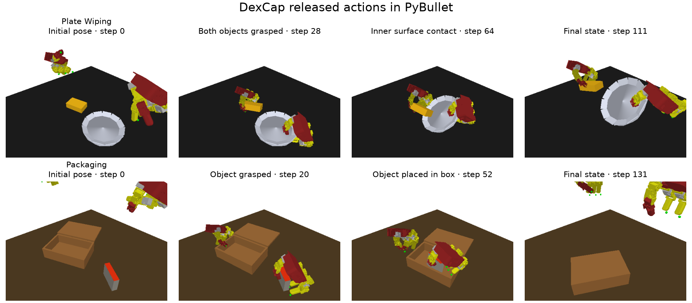

# DexCap 仿真

> 以下记录对应 PyBullet 基线。请在 [基线提交 `0ee5418`](https://github.com/ZSHYC/DexCap-repro/tree/0ee5418) 执行本文的命令。当前分支的入口见 [MuJoCo 运行方式](mujoco-migration.md)。

项目基于公开的 Wiping 和 Packaging 示范建立了无界面的 PyBullet 场景。作者公开了手部重定向和训练代码，并在上游说明仿真回放需要另外构建场景数字孪生。这里使用官方 LEAP 手 URDF，根据各任务 `demo_0` 的图像、点云和手部轨迹估计场景。 [作者关于仿真的说明](https://github.com/j96w/DexCap/issues/6#issuecomment-2209325098)

策略的两只手使用各自的腕部坐标。仿真用示范的 `frame_0_eef_quat` 和发布的标定配置将目标映射到同一个 Bullet 世界，执行后将模拟器的手部位姿与关节状态变回策略坐标。相机使用 HDF5 中的第一帧外参、发布的 L515 内参和 Bullet 深度缓存生成 `10000 × 6` XYZRGB 点云。控制频率为 20 Hz，物理步进为 240 Hz。

仿真和原始数据重建以官方台面平面做初筛。Packaging 还保留仿真桌面上方至少 2 cm 的可见点，使较远处的低矮物体在水平桌面模型中仍有点可采样。Bullet 以 L515 原始分辨率的四分之一宽高渲染，因此裁剪的像素数阈值除以 16。若裁剪后可见点不足 10000 个，则有放回采样。 [Packaging 视野对照](runs.md#packaging-初始点云覆盖)

官方数据构建按手部中心投影是否落在 84 × 84 图像内决定是否加入该手，再对完整 LEAP 网格采样并将 RGB 置零。仿真用同样的可见性规则，从 Bullet 各链节的实际位姿恢复手部网格表面。每只手在裁剪前采样约 5000 点，按渲染分辨率将官方的 80000 点除以 16。渲染时保留手对物体的遮挡，从深度点云中去掉手部像素，再加入手部表面采样，一同裁剪和下采样。桌面和物体仍使用渲染颜色。简化场景会改变手部点和场景点的比例。 [官方构建逻辑](../DexCap/STEP2_build_dataset/dataset_utils.py) · [对照结果](runs.md)

两只 LEAP 手的掌部按目标做运动学移动，任务物体是动力学刚体。手碰到对应物体时，模拟器用固定约束近似抓取，选取法向力最大的接触链节作为约束的父链节。持物会随该链节的后续运动。手部碰撞使用近似的接触刚度 (2500 N/m) 和阻尼 (50 N·s/m)，限制运动学手在碰撞时产生的过大冲量。两个场景均以 `demo_0` 为标定参考，省略了机械臂运动学、软材料形变以及抓取的力学细节。仿真指标只描述对应场景。 [Bullet 柔性接触示例](https://github.com/bulletphysics/bullet3/blob/master/examples/MultiBody/MultiBodySoftContact.cpp)

发布的数据构建代码把右手网格的局部 `y` 坐标取反，生成左手点云。仿真据此镜像同一右手 URDF 的关节、渲染和碰撞几何，使同组关节角在左右两手中生成镜像姿态。 [数据构建代码](../DexCap/STEP2_build_dataset/pybullet_ik_bimanual.py)

## 回放官方示范

在 `pro1` 进入项目并激活训练环境。运行依赖来自 `requirements-train.txt`，回放本身使用 CPU：

```bash
export DEXCAP="$HOME/dexcap-repro"
cd "$DEXCAP"
source "$DEXCAP/envs/conda/etc/profile.d/conda.sh"
conda activate "$DEXCAP/envs/train"
export DATASET="$DEXCAP/data/official/e468f07000de0f8d3234a9c60a9d8208344675e0/hand_wiping_1-14_5actiongap_10000points.hdf5"

python -m simulation.rollout "$DATASET" --output "$DEXCAP/runs/wiping-replay.json"
```

服务器上的 `data/derived/wiping-demo-0-playback.hdf5` 包含从官方文件取出的 111 步动作、相机外参和手部状态。完整 HDF5 下载期间可以将上面的 `DATASET` 指向这份文件。



图中使用官方 `demo_0` 动作和固定的外部观察相机。Wiping 在第 28 步抓到两件物体，第 64 步首次接触内盘面，111 步内累计 4 次擦拭。Packaging 在第 20 步抓取、第 52 步入盒，第 131 步结束时盖板已合。两组渲染的终态指标与常规命令的回放结果逐项一致。

从项目根目录用 CPU 重新生成关键帧图。

```bash
release=data/official/e468f07000de0f8d3234a9c60a9d8208344675e0
CUDA_VISIBLE_DEVICES= python -m scripts.render_demo_replays \
  "$release/hand_wiping_1-14_5actiongap_10000points.hdf5" \
  "$release/hand_packaging_wild_1-20_5actiongap_10000points.hdf5" \
  runs/dexcap-official-replay-keyframes.png
```

Wiping 场景以原始示范的 `frame_2220` 深度和官方首帧点云校准。把深度投影到 Bullet 场景使用的坐标后，在两个物体初始位置附近估计的台面高度约为 −0.035 m 到 −0.026 m，仿真用 −0.030 m 的水平面近似。盘子由 4 mm 的浅底和一圈斜面构成，盘缘约高 24 mm。海绵整体高度取 40 mm，海绵长轴相对 `+y` 方向旋转约 19°。 [原始数据重建](raw-retarget.md)

盘子需要两根不同手指同时形成相向接触后才建立抓取约束。两条接触法向的点积须小于 −0.25。盘子仍贴近桌面时，抓取约束上限为 20 N。盘子碰撞包围盒的最低点高于桌面 2 mm 后，抓取约束以当时盘心为目标位置，并把盘面法向调整到从 11 条官方示范估计出的右掌相对方向。Bullet 使用 200 N 上限执行这一朝向变化。这些近似分别描述离桌时的受力和提起后的持盘姿态。 [受力、标定与留出回放](runs.md#盘子离桌与擦拭阶段的受力)

## 运行闭环策略

从项目根执行。`CKPT` 指向 `runs/` 下实际保存的 Wiping checkpoint：

```bash
export PYTHONPATH="$DEXCAP/DexCap/STEP3_train_policy"
CUDA_VISIBLE_DEVICES=0 python -m simulation.rollout "$DATASET" \
  --checkpoint "$CKPT" --steps 12 \
  --output "$DEXCAP/runs/wiping-policy-smoke.json"
```

注意力模型用 `PYTHONPATH="$DEXCAP/worktrees/setxf/DexCap/STEP3_train_policy"`。策略每次读取最近三帧仿真观测。完成接口试跑后，去掉 `--steps` 用默认的 400 步时长评估。

`sponge_plate_contact_steps` 统计海绵与盘子的所有接触步。`wipe_surface_contact_steps` 统计海绵在距盘心 95 mm 内的内盘面上施加正向法向力的步数。半径按 Bullet 给出的盘侧触点计算。`wipe_distance` 以米计，累计连续内盘面接触时海绵相对于盘面的位移。 [盘沿接触审计](runs.md#擦拭接触点审计)

`wipe_passes` 沿世界竖直方向在盘面上的投影计数。每段连续正面接触确定一次投影方向，沿该方向的单程位移至少 6 cm，且竖直分量至少等于横向分量，才计一次。持续朝同一方向只计一次，随后可在转向后计下一次。同一侧的上下往返也可以计数。`sim_success` 要求两件物体都已触发抓取，并累计至少两次竖直擦拭。论文描述了方向和次数，6 cm 是本仿真根据公开轨迹采用的阈值。 [论文任务说明](https://arxiv.org/html/2403.07788v2#S5) · [实验记录](runs.md)

### 在相同摆放上比较 Wiping 策略

```bash
CUDA_VISIBLE_DEVICES=0 python -m simulation.rollout "$DATASET" \
  --checkpoint "$CKPT" --trials 20 \
  --output "$DEXCAP/runs/wiping-20-trials.json"
```

使用种子 1 到 20。每个种子分别在两件物体参考位置周围的 40 × 30 cm 区域采样，不采用盘子与海绵初始轮廓重叠的摆放。每轮重置策略，输出记录两个起始坐标、任务指标和汇总成功率。PointNet 和 SetXF 使用相同的种子与摆放。论文的试验次数和布置区域用于设计此协议，区域中心、固定相机和物理模型仍取自项目的近似场景。单次运行保持参考摆放。 [论文评估协议与任务细节](https://arxiv.org/html/2403.07788v2#S5.SS1.SSS0.Px4)

### 比较录制观测和仿真观测

在 Conda 环境中，从项目根对同一个 Wiping checkpoint 运行以下动作误差诊断。

```bash
CUDA_VISIBLE_DEVICES=0 python -m simulation.wiping_action_diagnostics \
  "$DATASET" "$CKPT" "$DEXCAP/runs/wiping-action-diagnostics.json"
```

用官方动作驱动仿真，取 `demo_0` 的 15 个时刻。分别将录制点云、录制相机外参渲染的点云、固定首帧相机渲染的点云送入策略，并在固定相机下额外比较仿真腕部状态。每次输入三帧、重置动作队列，分别采用三个扩散种子。输出记录每次首次动作相对官方动作的两腕位置误差、角度误差和指关节平均绝对误差。 [第 300 轮诊断](runs.md#wiping-第-300-轮配对结果)

## Packaging 仿真

纸盒底部和四壁构成一个有质量的刚体。盖板通过被动铰链连接，质心在面板中心，约 0° 和 180° 处模拟打开与闭合止挡。左手可以通过接触推动纸盒和盖板。右手两根不同手指在物体两侧施力时建立抓取。持物接触纸盒后，抓取从固定姿态改为固定夹持点，物体可在纸盒接触力作用下转动。拇指到其它指尖的最短距离相比持物时的最小值增大 4 cm 时，解除抓取约束。`box_displacement_m` 记录盒体起点与终点的水平距离，`box_center_progress_m` 记录回合中向桌面中心靠近的最大距离。

论文将入盒列为分项指标。仿真的 `object_in_box` 要求物体已释放，水平包络位于盒壁内，并且在盒底高度 ±2 mm 内受到朝上的法向支撑。物体顶部可以高出盒口。`lid_closed` 要求铰链角度距 180° 闭合止挡不超过 6°。终点同时满足入盒和合盖时，记录 `sim_success=true`。接触与角度容差是本仿真采用的判定参数。 [论文分项指标](https://arxiv.org/html/2403.07788v2#S5.SS1)

场景使用官方 `frame_2710` 的深度估计初始几何。仿真用 −3 cm 的水平面近似桌面。盒体外部平面尺寸约 29.8 × 19 cm，参考中心约为 `[0.482, 0.115] m`，初始偏航约 −62.8°。盖板初始向外展开，设定角度约 6°，铰链的近似阻力取 0.003 N·m。红银色包装主体的初始中心约为 `[0.517, -0.223] m`，仿真偏航约 64°。包装主体使用灰色材质，初始朝上的窄面有红色印刷层。 [测量与对照结果](runs.md)

```bash
PACKAGING_DATA="$DEXCAP/data/derived/packaging-demo-0-playback.hdf5"
python -m simulation.rollout "$PACKAGING_DATA" --task packaging \
  --output "$DEXCAP/runs/packaging-replay.json"
```

`PACKAGING_DATA` 可以换成版本目录下的完整 `hand_packaging_wild_1-20_5actiongap_10000points.hdf5`。为同一个 Packaging checkpoint 指定要评估的物体，种子固定为 1 至 5。

```bash
export PYTHONPATH="$DEXCAP/worktrees/setxf/DexCap/STEP3_train_policy"
CUDA_VISIBLE_DEVICES=2 python -m simulation.rollout "$PACKAGING_DATA" \
  --task packaging --checkpoint "$CKPT" --object blue-block --trials 5 \
  --output "$DEXCAP/runs/packaging-blue-block-5-trials.json"
```

每个种子在参考盒位周围的 10 × 10 cm 区域和参考物体位置周围的 40 × 30 cm 区域采样。不同物体使用同一相机和同样的摆放坐标。结果记录物体名、几何参考示范、每回合的 `box_xy` 和 `object_xy`，以及终点入盒率和完整成功率。省略 `--object` 时使用红银色包装物。 [论文的任务与初始摆放](https://arxiv.org/html/2403.07788v2#A1.SS6) · [实验记录](runs.md)

论文的完整 Packaging 协议覆盖 6 个训练中物体和 9 个未见物体。公开 Packaging HDF5 有 480 条序列，提供图像、点云和动作。论文图 10 提供物体照片，公开数据和源码缺少可直接用于仿真的物体网格、尺寸及分组标签。新增物体需要从可辨认的观测估计几何，并记录样本来源。 [论文评估协议](https://arxiv.org/html/2403.07788v2#S5.SS1.SSS0.Px4) · [固定版数据文件](https://huggingface.co/datasets/chenwangj/DexCap-Data/tree/e468f07000de0f8d3234a9c60a9d8208344675e0)

从这 480 条序列每隔 25 条抽取一张首帧图像和点云，共 20 张。六种物体以所见示范的 RGB 和点云估计外形。图像裁剪和遮挡会影响尺寸估算，所有物体均使用 0.12 kg 的刚体近似。

| `--object` | 几何参考 | 仿真形状及尺寸 |
|---|---|---|
| `red-box` | `demo_0` 红银色包装主体 | 长方体 12 × 3 × 8.7 cm |
| `blue-block` | `demo_50` 蓝色积木 | 长方体 11 × 5.5 × 3.6 cm |
| `green-pear` | `demo_100` 绿色梨形物体 | 椭球 5.8 × 5 × 5.4 cm |
| `green-can` | `demo_150` 绿色罐状包装 | 圆柱，直径 8.1 cm、高 6.8 cm |
| `tape-measure` | `demo_175` 黑黄卷尺状物体 | 圆柱，直径 7.6 cm、高 3.4 cm |
| `yellow-cloth` | `demo_225`、`demo_250` 黄色织物 | 长方体 15 × 13 × 4 cm |

抽样数据保存在 `pro1` 的 `data/derived/packaging-objects-keyframes.hdf5`，首帧拼图位于 `runs/packaging-objects-keyframes.png`。这些外观描述由录制图像得到，论文的评测分组需要结合图 10 确认。 [论文物体照片](https://arxiv.org/html/2403.07788v2/exp_obj_v3.png)

### 未见物体

作者第一段视频展示了 S&B 咖喱盒、红苹果、胶带分配器和 Mack’s 耳塞罐，第二段展示了长颈鹿、狮子、红黄积木堆和蓝色带把手杯。图 10 中还可见一个黑色弹簧夹。这些身份来自图像与录像，尺寸需另行估计。 [图 10](https://arxiv.org/html/2403.07788v2/exp_obj_v3.png) · [作者视频一](https://dex-cap.github.io/assets/normal_packaging_unseenobj.mp4) · [作者视频二](https://dex-cap.github.io/assets/normal_packaging_unseenobj2.mp4)

以参考纸盒的约 29.8 × 19 cm 外部平面和 7.8 cm 高度为尺度。苹果和耳塞罐用视频一 0.6 s 的八个盒角拟合针孔投影后估计轮廓。其余在视频中出现的物体用两视角同帧的盒体和物体轮廓估算，透视与遮挡带来的尺寸误差约为 15%–25%。弹簧夹只在图 10 出现，尺寸参考外观相似的 6.5 英寸产品，初始平放姿态由仿真设定。 [同类弹簧夹尺寸](https://www.usplastic.com/catalog/item.aspx?itemid=156410)

| `--object` | 仿真几何与初始姿态 |
|---|---|
| `red-apple` | 旋转椭球，平面直径约 7.9 cm、高 8.7 cm |
| `earplug-jar` | 圆柱包络，直径约 7.0 cm、高 11.8 cm |
| `golden-curry` | 窄边立起的纸盒，18.0 × 3.0 × 11.5 cm |
| `tape-dispenser` | 14.4 × 10.8 × 6.0 cm，含带中心孔的胶带卷与红色切带器 |
| `stacked-bricks` | 17.8 × 6.5 × 5.5 cm，横放的黄红阶梯状积木 |
| `blue-mug` | 13.3 × 9.9 × 11.0 cm（含把手），保留杯口与把手内侧空间 |
| `giraffe` | 12.6 × 3.5 × 16.6 cm，四足站立，保留细腿与长颈 |
| `lion` | 14.0 × 4.6 × 6.6 cm，四足站立，保留鬃毛、躯干与尾巴 |
| `spring-clamp` | 15.9 × 8.2 × 2.4 cm，平放的黑色双臂与橙色夹口，夹口保持闭合 |

复合模型用刚性拼接的盒体和圆柱近似接触面。完全闭合时，盒底上表面到盖板下表面的净高约 6.6 cm。苹果椭球的最小厚度约 7.9 cm，杯身直径约 9.5 cm，刚性近似会影响合盖。作者视频中苹果最终被盖板遮住，侧视可见窄缝，蓝杯的盖板明显被顶起。两件物体被盒底支撑时均可计为入盒。所有未见物体都通过 `--object` 选择，结果包含 `object_group=unseen` 和 `object_reference`。 [苹果视频 43.0–46.1 秒](https://dex-cap.github.io/assets/normal_packaging_unseenobj.mp4) · [蓝杯视频 35.0–42.8 秒](https://dex-cap.github.io/assets/normal_packaging_unseenobj2.mp4)

以下命令用同一个 checkpoint 评估九个物体，每种运行五组相同的摆放。`PACKAGING_RUN` 指向 `runs/` 下该次 Packaging 正式训练的目录。训练物体评估退出后，从项目 Conda 环境和上文 SetXF 的 `PYTHONPATH` 运行。

```bash
cd "$DEXCAP"
mkdir -p "${PACKAGING_RUN}-unseen-final"
objects=$(python -c 'from simulation.packaging import PACKAGING_UNSEEN_OBJECTS; print(*PACKAGING_UNSEEN_OBJECTS)')
for object in $objects; do
  CUDA_VISIBLE_DEVICES=2 python -m simulation.rollout "$PACKAGING_DATA" \
    --task packaging --checkpoint "$CKPT" --object "$object" --trials 5 \
    --output "${PACKAGING_RUN}-unseen-final/$object.json"
done
```

## 汇总正式仿真结果

在 `pro1` 上用以下命令从正式实验的逐回合记录重新生成汇总。换到另一组训练时，传入对应的两个 Wiping JSON 和 Packaging 训练目录。 [本次正式汇总 JSON](assets/dexcap-formal-simulation.json)

```bash
cd "$DEXCAP"
python -m simulation.summarize_results \
  runs/wiping-pointnet-seed1-final-sim.json \
  runs/wiping-setxf-seed1-full-20261119T103025Z.final-sim.json \
  runs/packaging-setxf-seed1-full-20261119T111945Z \
  --output runs/dexcap-formal-simulation.json
```

命令要求第 3000 轮的权重、每回合 400 步，并核对两组 Wiping 的 20 个摆放以及 Packaging 所有物体的五个摆放。Wiping 汇总抓盘、抓海绵、同一回合两件都抓到、至少一步内盘面接触，以及完整成功的回合数和比例。Packaging 汇总入盒、合盖与完整成功，并保留逐物体计数。六种训练物体共 30 回合，九种未见物体共 45 回合。
